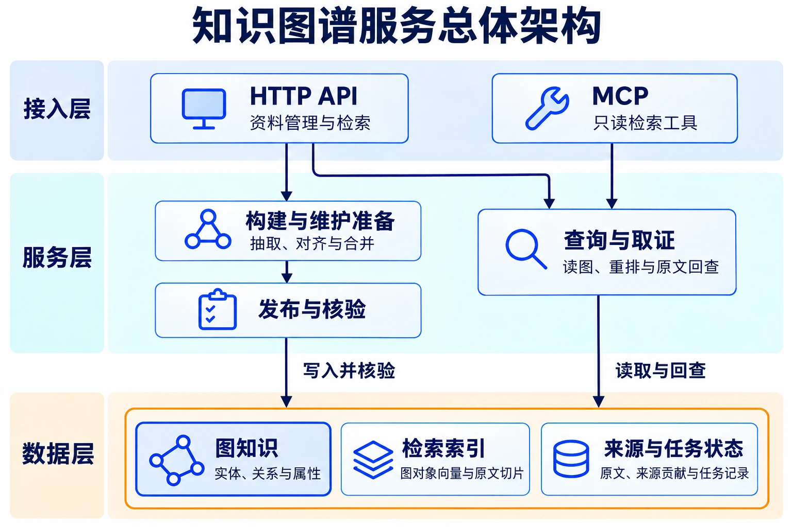

# 可配置知识图谱服务

把合同、技术说明和结构化资料构建成可追溯的实体、关系与条款。调用方通过 HTTP 或 MCP 查询图关系和相关原文，拿到出处后再组织回答或执行业务操作。

业务接入方定义对象类型、身份字段和合并规则。服务负责解析、抽取、建图和来源维护。例如查询一份合同的付款承诺，可以返回条款正文、适用条件和原文位置。撤回一份资料时，其余来源仍支持的事实会继续保留。

[项目概览 HTML](docs/project-overview.html)可下载后离线打开。[快速开始](#快速开始)提供可运行的接入示例。

> [!NOTE]
> **本轮迭代（2026-11-08）**
>
> - **构建**　保留全文抽取。长文可按标题和段落分窗，只补抽已发现的条款证据缺口。
> - **检索**　沿用融合召回，以核验过的摘录做紧凑重排。命中实体后可补同源段落，原文路线保留互补切片。
> - **发布**　导入和撤回只重算受影响的对象及依赖。准备期间旧知识可查，写入中断后按原计划恢复。
>
> [迭代优化设计](docs/02-项目设计/迭代优化设计-2026-11-08.md) · [评测说明与结果](docs/03-使用与验证/评测说明与结果.md)

## 知识构建、检索与维护

| 能力 | 设计 | 可见的结果 |
| --- | --- | --- |
| 长文构建 | 物理切片负责索引与引用。结构化抽取沿标题、段落和列表组窗，条款粒度由业务模型约束。也可用全文优先。 | 同模型重建对照中，长合同入图的事实证据由 **12/30 到 29/30**。 |
| 图与原文取证 | 精确、关键词和向量融合召回。紧凑重排用经过核验的摘录选候选。实体详情可补同源上下文，原文按来源坐标保留互补片段。 | 固定实体候选的公开长文回放，完整覆盖由 **6/17 到 11/17**。 |
| 按来源维护 | 保存事实贡献与原文归属。导入、删除只重算受影响的对象及依赖，符合条件的文本可复用向量。 | 可撤回资料独有的字段、索引和证据，并保留仍有来源支持的关系。 |
| 可恢复发布 | 将抽取和向量计算放在准备阶段。跨库可并行准备，正式发布按计划写入并核验。 | 准备期间旧知识可查。写入中断时沿用原对象 ID 与已计算向量恢复。 |

输入支持 TXT、Markdown、Word（DOCX）、文本型 PDF 以及显式映射的 CSV/JSON。Markdown 与 Word 保留标题路径，Word 正文与常规表格能回查原位置。

## 长合同验证

完整 CUAD 长合同包含 35,525 字节原文。固定 Top 5，12 个问题分别走图实体和原文两路，另有 2 个自然语言检索动作。通过指找齐对应原文证据。

| 检索方式 | 首版基线 | 当前版代表性复测 |
|---|---:|---:|
| 图谱实体检索，含详情取证 | 10/12 | 12/12 |
| 原文切片检索 | 11/12 | 12/12 |
| 自然语言组合检索 | 2/2 | 1/2 |
| **合计** | **23/26** | **25/26** |

首版用 GLM‑5.3 与 Gemini Embedding 2。当前版复用已发布的结构化构建快照，以 GPT‑6 Sol 做重排和自然语言规划，查询向量使用 text-embedding-3-large。这是同一合同、同一口径下两套配置的代表性结果。构建、同模型对照及其他数据集结果见[评测说明](docs/03-使用与验证/评测说明与结果.md)，首版原始记录见[发布证据](evals/published/README.md)。

## 架构

Neo4j 保存图知识，Qdrant 辅助定位图对象与原文，PostgreSQL 保存任务状态和来源贡献。



| 模块 | 职责 |
|---|---|
| HTTP / MCP / CLI | 接收请求、校验协议参数、调用共享服务 |
| 业务服务 | 模型配置、资料登记、知识构建维护和检索 |
| 领域与端口 | 业务规则、结果契约及存储能力接口 |
| 适配器 | Neo4j、Qdrant、PostgreSQL、文件、解析器及模型调用 |
| 运行时 | 查询门禁、进程锁、后台任务和取消处理 |

依赖方向为 `interfaces → services → domain/ports`，适配器由 `bootstrap` 统一装配。默认部署为同一 Linux 主机上的单 API 进程与单 Worker。启用分布式准备时，准备 Worker 可独立部署，API 与发布 Worker 仍同机协调查询门禁。

构建分为准备和正式写入两个阶段：准备期间旧知识仍可读；正式写入前等待在途读取退出，维护完成前拒绝新的知识查询。完整设计见[架构设计](docs/02-项目设计/架构设计.md)与[实施设计](docs/02-项目设计/实施设计.md)。

## 快速开始

需要 Linux 或 WSL Ubuntu、Python 3.12、uv，以及可访问的 PostgreSQL、Neo4j、Qdrant 和模型服务。项目使用 Linux 文件锁，运行数据应位于 Linux 本地文件系统。以下以仓库路径 `/srv/knowledge-graph` 为例。

### 1. 安装依赖

```bash
cd /srv/knowledge-graph
uv venv --python 3.12 .venv
uv pip sync --python .venv/bin/python requirements.lock
uv pip install --python .venv/bin/python --no-deps -e .
```

已有项目虚拟环境时跳过创建步骤。正式依赖由项目独立管理。

### 2. 配置服务与凭据

```bash
cp --no-clobber configs/app.example.yaml configs/app.local.yaml
cp --no-clobber configs/environment.example .env
chmod 600 .env
export KG_CONFIG=/srv/knowledge-graph/configs/app.local.yaml
```

编辑配置中的存储地址、数据目录、模型端点和名称；在 `.env` 中取消所需变量的注释并填写凭据。示例使用 OpenRouter 的 GLM 5.3 和 Gemini Embedding 2，设置 `OPENROUTER_API_KEY` 后可接入；先创建空 PostgreSQL 数据库，再在 `.env` 中设置 `POSTGRES_DSN`，初始化账号需能在目标 schema 创建表和索引。配置加载顺序、不同安装路径和部署方式见[运行指南](docs/03-使用与验证/运行指南.md)。

结构化映射可以不调用 LLM，但构建向量索引仍需要真实 Embedding；文本抽取和自然语言规划还需要 LLM。项目不提供模拟模型运行模式。

### 3. 初始化并启动

API 与 Worker 均停止时初始化存储：

```bash
.venv/bin/kg init-storage
```

随后在两个终端分别启动，均使用同一份配置：

```bash
export KG_CONFIG=/srv/knowledge-graph/configs/app.local.yaml
.venv/bin/kg serve
```

```bash
export KG_CONFIG=/srv/knowledge-graph/configs/app.local.yaml
.venv/bin/kg worker
```

| 入口 | 默认地址 |
|---|---|
| HTTP API | `http://127.0.0.1:8000/api/v1` |
| OpenAPI 文档 | `http://127.0.0.1:8000/docs` |
| MCP Streamable HTTP | `http://127.0.0.1:8000/mcp` |
| 就绪检查 | `http://127.0.0.1:8000/api/v1/health/ready` |

### 4. 导入与检索

```bash
.venv/bin/kg model validate examples/service-catalog/model.yaml
.venv/bin/kg kb create service-demo examples/service-catalog/model.yaml
```

将返回值分别代入 `KB_ID`、`JOB_ID`：

```bash
.venv/bin/kg documents upload KB_ID examples/service-catalog/source-a.csv --key import-a
.venv/bin/kg jobs get JOB_ID
.venv/bin/kg jobs issues JOB_ID
.venv/bin/kg search KB_ID pay-core --no-semantic
```

上传成功表示任务已登记；Worker 成功提交后资料才参与当前知识库。完整删除、重建、重试及检索用法见[运行指南](docs/03-使用与验证/运行指南.md)。

MCP 提供五个只读工具：`describe_model`、`search_knowledge`、`get_knowledge`、`query_graph`、`retrieve`。检索结果包含 `status`、`coverage`、`conflicts` 和待消歧对象；候选 Top-K 不代表完整图集合，也不自动确认实体身份。

## 适用边界

- 只维护当前知识，资料更新采用删除成功后重新导入；不提供历史版本查询或直接编辑图事实的管理入口。
- 公开合同小样本尚未完成业务方语义验收；扫描 PDF、复杂表格和企业私有语料没有形成验收结论。
- 单机和分布式准备模式仍缺少生产负载、容量和高可用验收。
- 代码默认检索预算为 15 秒，首版与当前版的代表性运行分别使用 180 秒和 150 秒，实际耗时与覆盖按各轮配置记录。
- 当前应用面向可信环境，完整多用户权限体系不在首版范围内。

## 仓库结构

```text
src/knowledge_graph/    分层应用源码
configs/                运行配置与凭据变量模板
deploy/                 API、Worker 的 systemd 模板
examples/               服务目录和合同业务模型与样例
evals/                  评测程序、语料、case计划及精选发布证据
scripts/                本地检查入口
docs/                   学习笔记、设计、运行与验证说明
```

本机凭据、运行数据、完整评测档案、缓存及本机配置不纳入版本控制。`evals/published/` 是带来源标识的脱敏发布副本，完整的运行档案保留在本地。

## 文档

- [文档导航](docs/README.md)：按概念、设计、运行和验证查找资料。
- [架构设计](docs/02-项目设计/架构设计.md)：系统边界、存储归属和维护语义。
- [实施设计](docs/02-项目设计/实施设计.md)：代码分层、数据结构、接口和恢复机制。
- [迭代优化设计](docs/02-项目设计/迭代优化设计-2026-11-08.md)记录分窗抽取、检索取证和差量发布的取舍。
- [运行指南](docs/03-使用与验证/运行指南.md)：安装、配置、启动、使用与排错。
- [评测说明与结果](docs/03-使用与验证/评测说明与结果.md)：复现方式、实际结果和未验证范围。
- [后续能力探索](docs/02-项目设计/面向业务落地的能力演进与探索-2026-11-08.md)记录资料更新、业务语义、权限和 Agent 交互的演进方向，附公开资料与验证思路。

第三方语料的来源和许可保留在[语料来源清单](evals/corpus/cuad/source-manifest.json)中。
