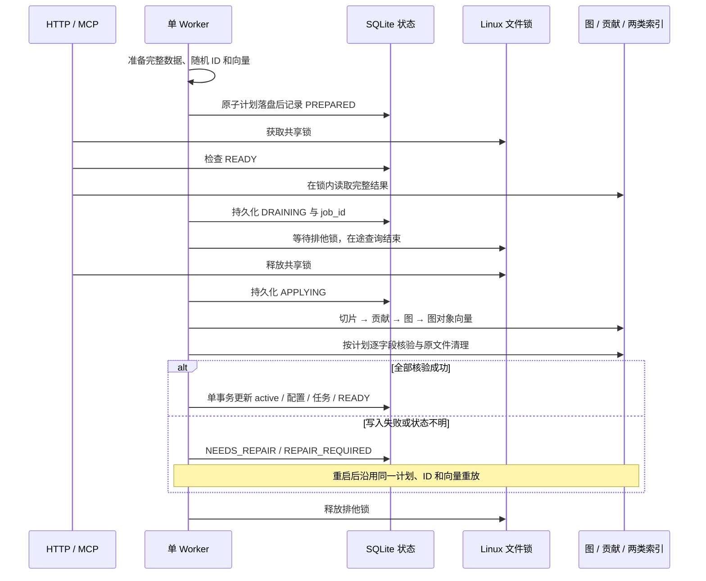

# 知识图谱项目实施设计

编写日期：2026-11-01。  
状态：核心功能已按本设计分层实现，正式依赖与真实模型已接入。机制、恢复与专项边界已有通过证据，合同质量仍有未完成项；实际结果以运行说明、评测记录为准。

本文承接[架构设计](架构设计.md)，回答模块怎样组织代码、数据怎样落库、请求怎样执行，以及失败后怎样恢复。运行方法与已完成检查分别见[运行指南](../03-使用与验证/运行指南.md)和[工程验证与限制](../03-使用与验证/工程验证与限制.md)。

## 阅读导航

| 关注点 | 对应章节 |
|---|---|
| 总体实现与技术选择 | [1. 实施基线](#1-实施基线)、[2. 代码分层](#2-代码分层与模块职责) |
| 模型怎样输入、对象怎样存储 | [3. 配置与模型](#3-配置与业务模型)、[4. 数据设计](#4-数据结构与存储实现) |
| 资料怎样形成知识 | [5. 构建流水线](#5-资料登记与知识构建) |
| 两个进程怎样安全写入和恢复 | [6. 任务与一致性](#6-任务执行一致性与恢复)、[7. 删除与重建](#7-删除重新导入与模型调整) |
| 自然语言怎样检索、Agent 怎样调用 | [8. 检索实现](#8-知识检索实现)、[9. 对外接口](#9-http-api-与-mcp-接口) |
| 怎样运行、验证和扩展 | [10. 本地运行](#10-本地运行与工程约定)、[11. 验证设计](#11-测试与效果验证)、[12. 实现与扩展边界](#12-当前实现与扩展边界) |

## 1. 实施基线

### 1.1 已确定的边界

- 图知识库是当前知识的核心载体；向量索引分为图对象索引和文档切片索引。
- 外部明确输入节点类型、边关系和建模规则；普通导入抽取实例，不自动修改模型。
- 原始资料先保存并登记任务；来源贡献精确到属性值、描述片段或关系声明。
- 文档切片正文、向量和位置共同保存在 Qdrant。SQLite 不建立另一份永久切片正文库，也不保存当前实体、关系的完整主库。
- 更新采用删除成功后重新导入；无知识历史版本、历史回滚或自动文件替换。
- HTTP API 与 MCP 共用检索服务。业务计算、问数及最终回答由外部 Agent 执行。
- 同一知识库的构建、删除、模型调整串行处理；准备阶段可查询，正式写入期间暂停知识查询。

### 1.2 技术选择及依据

下表为正式实施基线。已有基础设施不重新部署；正式项目使用独立 `.venv`，实际依赖已写入 `pyproject.toml` 和不含文件摘要的 `requirements.lock`。

| 职责 | 实施选择 | 当前依据或限制 |
|---|---|---|
| 运行环境 | WSL2 Ubuntu 24.04，Python 3.12，uv | 已有环境；正式项目单独管理依赖 |
| 在线接口 | FastAPI、Uvicorn、Pydantic v2 | 采用现有 Python 技术路线；首版一个在线服务进程 |
| MCP | 官方 Python SDK，Streamable HTTP | 作为同一 ASGI 服务的 `/mcp` 入口，直接调用共享服务 |
| 图存储 | Neo4j Community，官方 Python 驱动 | 现有服务已做基础验证；实体、关系、规则及聚合属性保存在图中 |
| 向量与切片 | Qdrant、官方 Python 客户端 | 现有服务已验证；使用文本向量和 payload |
| 元数据 | Python `sqlite3`、参数化 SQL | 保存有效配置、资料、任务、来源贡献、未采用候选 |
| 原文件与检查点 | WSL Linux 文件系统 | UUID 目录，原子替换文件；与 SQLite 一起属于资料来源任务存储 |
| 后台执行 | 独立 Python Worker、持久化任务表 | 首版全局单 Worker；不增加消息队列服务 |
| 文档解析 | TXT/Markdown、JSON/CSV；文本型 PDF 使用 pypdf | 扫描 PDF、复杂表格需另外验证解析适配，不把无文本解析伪装成成功 |
| 模型调用 | HTTPX；OpenRouter OpenAI 兼容协议 | GLM 5.3 与 Gemini Embedding 2（3072维）；具体结果见评测记录 |
| 工程检查 | Ruff、编译/导入、启动及集中端到端评测 | 不配置重复的单元测试套件；离线边界排错不冒充真实业务效果 |

FastAPI 的路由模块负责组织 HTTP 入口；MCP SDK 提供协议与工具结构，业务流程由项目自己的服务层承担。[FastAPI 多模块应用](https://fastapi.tiangolo.com/tutorial/bigger-applications/)、[MCP Python SDK](https://github.com/modelcontextprotocol/python-sdk)

SQLite 首版使用 `journal_mode=DELETE`、`synchronous=FULL`、`foreign_keys=ON`、`busy_timeout=5000`。这里的 DELETE 是日志模式。所有写事务保持短小，模型调用和数据库网络操作不得放入 SQLite 事务。

SQLite 显式使用回滚日志（`journal_mode=DELETE`），配合短事务和文件锁管理写入；当前不启用 WAL。[回滚日志与文件锁](https://sqlite.org/lockingv3.html)

采用 SQLite 的前提是 API、Worker 和元数据文件位于同一台 WSL 主机，维护负载较低。增加多机运行或大量并行写入时，需要评估 PostgreSQL，并单独设计数据迁移；本设计不承诺无改动扩容。

### 1.3 进程与部署关系

```text
外部系统 ── HTTP API ─┐
                     ├─ 在线服务进程 ─ 检索服务 / 资料与任务登记
外部 Agent ─ MCP ────┘                   │
                                      SQLite 任务表
                                           │
                                  单 Worker 进程
                                           │
                                   构建 / 删除 / 重建

两进程共享：业务模型、领域对象、存储适配器、知识库查询门禁
正式数据：SQLite + 原文件目录 / Neo4j / Qdrant
跨进程协调：持久化维护状态 + Linux 文件共享锁/排他锁
```

在线服务只登记维护请求，Worker 执行图、贡献和索引维护。CLI 通过 HTTP 管理接口提交配置或任务；除离线初始化命令外，不建立另一条直接修改正式数据的路径。

## 2. 代码分层与模块职责

### 2.1 目标目录

以下分层已在代码中建立。文件按实际复杂度拆分，不为每个处理动作创建独立服务。公共端口由组合根注入，服务层不直接访问数据库 SDK 或文件实现。

```text
src/knowledge_graph/
├── bootstrap.py                    # 配置、连接池、依赖组装和生命周期
├── server.py                       # ASGI 应用入口
├── worker.py                       # Worker 入口、领取任务、恢复优先调度
├── settings.py                     # 运行配置
├── domain/
│   ├── model.py                    # 业务模型、字段定义与身份规则
│   ├── knowledge.py                # 实体、关系、规则及冲突结构
│   ├── source.py                   # 资料、切片、位置与来源贡献
│   ├── jobs.py                     # 任务状态和写入计划
│   └── errors.py                   # 稳定的领域错误码
├── services/
│   ├── contracts.py               # HTTP/MCP 共用的请求与结果结构
│   ├── model_config/              # 校验、绑定、模型调整请求
│   ├── documents/                 # 原文登记、幂等请求、任务管理
│   ├── construction/
│   │   ├── pipeline.py            # 导入准备过程
│   │   ├── extraction.py          # 抽取/映射和证据校验
│   │   ├── alignment.py           # 身份匹配和 ID 分配
│   │   ├── source_references.py   # 来源单元授权、精确引用与坐标映射
│   │   ├── merge.py               # 按来源合并、冲突保留
│   │   ├── maintenance.py         # 删除、整库重建、索引重建
│   │   └── apply.py               # 执行写入计划、验证和恢复
│   └── retrieval/
│       ├── search.py              # 精确、关键词与向量候选检索
│       ├── graph.py               # 邻居、遍历与路径查询
│       ├── retrieve.py            # 自然语言规划及组合检索
│       └── evidence.py            # 读取来源与片段，组织证据
├── ports/
│   ├── metadata.py                # 元数据事务与来源查询协议
│   ├── graph.py                   # 图读写、身份查询、遍历协议
│   ├── vectors.py                 # 两类索引与切片读取协议
│   ├── files.py                   # 原文件、检查点、解析协议
│   └── language.py                # LLM、Embedding、可选 Rerank 协议
├── adapters/
│   ├── metadata/                  # sqlite3、表结构和迁移脚本
│   ├── neo4j/                     # 固定 Cypher 模板、约束与索引
│   ├── qdrant/                    # collection、payload 与过滤
│   ├── files/                     # 本地路径、原子文件写入
│   ├── parsers/                   # 文本、结构化资料、PDF
│   └── models/                    # OpenAI 兼容 HTTP 适配
├── runtime/
│   ├── read_gate.py               # 知识库读门禁、来源文件上传/回收锁
│   └── worker_lock.py             # 单 Worker 进程锁
├── interfaces/
│   ├── http/                      # 路由、参数绑定、HTTP 错误映射
│   ├── mcp/                       # 五个检索工具及协议生命周期
│   └── cli/                       # 管理命令，调用管理 API
└── prompts/                       # 抽取、描述整理、检索规划模板
```

### 2.2 依赖方向与对象边界

`interfaces → services → domain/ports`；`adapters` 实现 `ports`，由 `bootstrap` 注入。`runtime` 为服务入口与写入执行器提供协调机制。服务层不导入 FastAPI、MCP SDK 或数据库客户端；适配器不决定业务身份、合并规则与冲突取舍。

Pydantic 用于模型配置和共享请求/结果结构的校验。内部领域对象可以使用 dataclass 或明确的 Pydantic 模型，避免同一对象在每层复制一套字段。业务类型通过配置表达，不定义写死的 `PaymentService`、`ContractParty` 等专属代码类。

| 模块 | 主要输入 | 主要输出 | 不承担的职责 |
|---|---|---|---|
| 模型配置 | 完整的结构化模型定义 | 校验结果、有效模型或重建任务 | 从资料自动猜出并启用模型 |
| 资料与任务 | 文件、知识库 ID、来源、幂等键 | 资料 ID、任务 ID、状态 | 直接抽取和写图 |
| 构建维护 | 已登记资料、有效模型、已有贡献 | 写入计划、执行结果 | 处理 HTTP/MCP 协议 |
| 检索 | 查询、ID、范围和预算 | 知识、关系、证据、歧义与覆盖说明 | 业务计算、最终回答生成 |
| 存储适配 | 已校验的读写请求 | 存储结果或统一异常 | 通过名称相似度决定实体身份 |

存储协议采用实际需要的粗粒度方法，例如 `find_by_identity`、`load_contributions`、`apply_graph_patch`、`upsert_chunks`、`read_chunks`，不为每条 SQL 建接口。接口层只转换协议字段，核心结果对象共用。

### 2.3 异步与阻塞操作

HTTP、MCP、网络模型调用和数据库网络调用采用异步接口。文件解析及 SQLite 事务通过受限线程池执行；一次 SQLite 事务在同一线程、同一连接内完成。查询不跨网络调用持有 SQLite 读事务。

进程共享连接池，单次请求创建会话；事务内不执行 LLM 调用。Neo4j 驱动可能重试事务回调，回调只执行已准备好的幂等数据库操作，ID 分配、模型调用和跨库写入都在回调之外。[Neo4j 事务说明](https://neo4j.com/docs/python-manual/current/transactions/)

## 3. 配置与业务模型

### 3.1 三类配置

| 类别 | 提交位置 | 运行时读取方式 |
|---|---|---|
| 系统运行配置 | `configs/app.example.yaml`、环境变量 | `settings.py`；环境变量覆盖文件 |
| 业务模型配置 | `examples/<scenario>/model.yaml` 或调用方提供的文件 | 校验后保存到 SQLite 的知识库有效配置 |
| 凭据 | 本机环境变量或项目本地 `.env` | 通过配置加载器读取，不写入模型配置、任务清单或日志 |

业务模型配置文件只是提交载体。修改磁盘上的 YAML 不会直接修改在线模型；初次绑定和后续模型调整都通过明确的管理操作进行。

运行配置至少包含存储地址、数据根目录、LLM/Embedding 参数、解析切分参数、并发与超时、检索预算。配置保存完整的非敏感字段；兼容性按这些字段直接比较，配置修订标识采用随机 UUID。项目不提供知识历史查询。

`llm` 用于在线检索规划。可选 `construction_llm` 为构建抽取、规则组装和摘要提供完整独立的模型配置；未设置时复用 `llm`。它不是部分覆盖对象，模型名称、端点、预算和凭据环境变量名称均按该 profile 解释。二者共享 Embedding 配置和存储端口，不改变有效业务模型或正式恢复计划。应用关闭时按客户端实例去重释放连接；评测按实际客户端记录构建/检索调用，并共用额度停止门禁。

### 3.2 模型配置示例

服务依赖仅作为机制说明与确定性测试样例，不替代真实业务场景的评测。示例结构如下：

```yaml
name: service-catalog
node_types:
  Service:
    description: 可独立识别的业务服务
    identity:
      namespace: service
      fields: [app_id]
      normalization: [trim]
    properties:
      app_id: {type: string, required: true, merge: single}
      name: {type: string, required: true, merge: alternatives}
      aliases: {type: string_list, merge: union}
      description: {type: string, merge: supported_text}
  Team:
    description: 对服务负责的团队
    identity:
      namespace: team
      fields: [team_code]
      normalization: [trim]
    properties:
      team_code: {type: string, required: true, merge: single}
      name: {type: string, required: true, merge: alternatives}
relation_types:
  CALLS:
    source_types: [Service]
    target_types: [Service]
    identity_properties: []
    properties: {}
  OWNED_BY:
    source_types: [Service]
    target_types: [Team]
    identity_properties: []
    properties: {}
    conflict_rule: {max_distinct_targets: 1}
extraction:
  instructions:
    - 只抽取原文明确支持的实体、属性和关系。
    - 名称相同但业务标识不同的服务分别建模。
domains: []
```

配置校验包括类型名唯一、字段定义、身份字段存在、关系端点可引用、关系身份属性定义、领域层级无环、规则枚举合法。配置中不接受任意 Python 表达式或可执行脚本。

身份规范化由字段规则指定，不能对所有业务编码自动转小写。缺少可靠身份字段时，候选进入未采用结果；接入方可以显式选择“来源内局部身份”，其键包含文档 ID，这类对象不自动跨资料合并。

字段类型、身份字段和关系端点属于硬约束。当前 Neo4j 适配的完整规范化 identity_key/relation_key JSON 限制为 4096 个 UTF-8 字节，为复合索引其他字段保留余量；超限明确拒绝，不截断、不改用摘要。声明 queryable 的整数属性（包括 number 中的整数）限制在 signed 64 位范围，准备阶段即识别，避免正式写入后形成无法重放的计划。非投影的 JSON 业务数值不额外套用此整数范围。普通实体候选还须满足业务必填项；可靠身份已经确认、但仅作为关系端点出现的实体允许缺少其他字段，标记 `completeness=identity_only` 和 `missing_fields`。来源撤回后也重新计算该标记，不能为满足必填项保留已失去依据的名称。身份本身不完整时仍拒绝建立端点。

单值、互斥或唯一归属属于来源冲突规则。冲突时保留各自声明与证据，不把后上传的值当作最终事实，也不丢弃另一个来源。

### 3.3 结构化资料映射

字段映射与类型定义一起提交到业务模型的 `mappings`。上传时可传 `mapping_id`；CSV/JSON 未指定且没有唯一适用映射时返回配置错误，不自动猜测关联字段。以下将一行 CSV 映射为两个服务及一条调用关系：

```yaml
mappings:
  service_calls:
    format: csv
    records: {header: true, encoding: utf-8}
    entities:
      caller:
        type: Service
        fields:
          app_id: {column: caller_id, cast: string, empty: error}
          name: {column: caller_name, cast: string, empty: error}
      callee:
        type: Service
        fields:
          app_id: {column: callee_id, cast: string, empty: error}
          name: {column: callee_name, cast: string, empty: error}
    relations:
      - {type: CALLS, source_ref: caller, target_ref: callee}
```

```csv
caller_id,caller_name,callee_id,callee_name
order-service,订单服务,payment-service,支付服务
```

该行产生 `row:1/caller`、`row:1/callee` 两个临时实体引用和一条连接两者的 CALLS 候选；正式 ID 由统一对齐模块生成。每个字段的证据指向该行对应列，关系证据包含两端编码单元格及“本映射表示调用关系”的配置标识。

JSON 映射使用 `records: {pointer: /calls}` 选择数组；根数组使用空 pointer。字段使用相对每条记录的 `pointer: /caller_id` 替代 column。首版不支持执行表达式或跨文件 join。`cast` 只允许声明的 string/integer/number/boolean/date 转换；缺字段和空值按 `empty=error/omit` 处理，必填字段不得 omit。转换失败保存未采用原因，不按零值或空串补齐。结构化数据的关系含义由接入方提供的映射明确授权，不能靠列名猜测。

### 3.4 规则知识的表达

需独立检索的业务规则作为配置中的一种节点类型，使用 `entity_id`，包含完整定义、适用条件、例外条件和相关对象。附属在节点或边上的条件随所属对象读取。

规则类型在配置中声明不可拆分的字段组，例如 `atomic_groups: [{name: rule_statement, fields: [definition, conditions, exceptions, scope]}]`。同一来源的一份完整声明作为一个聚合单位，并关联全部支持区间；不同来源不能分别提供条件与例外后拼成一条没有完整出处的新规则。

抽取模板从当前模型生成允许的类型、字段和关系端点。每项候选必须指向输入的片段和支持语句。模型生成的“规则摘要”只供检索，不能替代完整规则正文；无法确定完整条件或跨段指代时标记未采用，保留原文检索能力。

## 4. 数据结构与存储实现

### 4.1 标识与知识库范围

| 标识 | 生成方式 | 稳定范围 |
|---|---|---|
| `kb_id`、`document_id`、`job_id` | UUIDv4 | 各自记录的生命周期 |
| `entity_id`、`relation_id` | 新对象 UUIDv4，已有对象按身份规则复用 | 对象存在期间及同一任务重试 |
| `chunk_id` | UUIDv4；与资料 ID、解析位置及解析配置一同写入准备计划 | 同一份持久化计划的重放复用，重新准备可分配新 ID |
| `contribution_id` | UUIDv4；先按资料、片段、目标、字段路径及声明原值直接去重，再写入准备计划 | 同一条持久化来源贡献重放 |
| `identity_key`、`relation_key` | 明确的命名空间、业务身份字段原值及规范化 JSON；关系包含端点 ID、类型及身份属性原值 | 数据库唯一约束和直接值比较；键不经过摘要转换，不作为公开 ID |

删除后重新导入产生新 `document_id`。仍存活的图对象按身份规则复用 ID；已经移除的对象重新出现时分配新 ID。关系身份由起终点 ID、关系类型及模型声明的身份属性共同确定，普通可变属性不进入身份键。

所有适配器方法必须接收 `kb_id`，不能依赖调用方自行拼接过滤。图对象、贡献和切片不得跨库关联。知识库是管理和检索范围，业务领域是其中的分类，两者分开。

### 4.2 文件存储

```text
data/
├── metadata.sqlite3
├── raw/<kb_id>/<document_id>/original.<ext>
├── jobs/<job_id>/
│   ├── preparation.json           # 准备代次、配置与已完成模型结果的可恢复草稿
│   └── prepared.json              # 单一原子发布计划：对象、切片、贡献、向量与清理步骤
└── locks/
    ├── worker.lock
    ├── source-files.lock           # 上传持共享锁；孤立原文件回收尝试排他锁
    └── <kb_id>.lock
```

原始文件名只存入元数据，文件路径由系统生成的 UUID 构成。上传先写临时文件，记录字节长度，完成 fsync 后原子改名并同步父目录；随后用一个 SQLite 短事务登记资料与任务。

检查点采用同样的临时文件、fsync 和原子改名顺序。当前实现将完整计划原子发布到单个 `prepared.json`，封装随机计划 ID、格式版本、负载完整性校验值、规范化 JSON 负载的 UTF-8 字节长度、对象 ID 集合、固定业务字段清单和负载本身，然后将任务标为已准备。对象、切片、贡献和已计算向量都在该文件内，不依赖多文件发布顺序。准备中的 `preparation.json` 还保存 queue_seq 代次和已完成模型结果。正式切片正文仍只由 Qdrant 管理；任务文件不是另一个可检索知识库。 所有随机 ID 必须在进入正式写入前持久化；恢复只能加载这份计划。恢复时校验负载内容、长度、结构和引用，发现意外损坏后拒绝重放。新版封装兼容读取旧计划；旧计划继续使用原有检查。原子发布与受控文件权限是计划持久化的前提，完整性校验不替代权限保护。

成功任务的中间文件在不再需要恢复后清理，默认保留24小时，由Worker定期回收。清理失败单独记录 `cleanup_pending`，不把它伪装成知识同步失败或内容告警。需要修复的任务必须保留检查点；准备失败材料在仍可重试期间保留，但资料删除时按第 7.1 节清理。上传从暂存、发布到元数据登记或清理完成，始终持有 `source-files.lock` 共享锁；孤立文件回收只有立即取得排他锁才读取引用路径并删除超龄文件，取不到便跳过本轮。保留期可配置为0；并发安全依靠该锁，不能只依靠24小时默认值。

### 4.3 SQLite 元数据

以下字段对应已实现的 SQLite 元数据语义，实际 DDL 与初始化检查位于 `adapters/metadata/sqlite.py`。时间统一保存 UTC ISO 8601，展示时转换时区。

| 表 | 关键字段 | 约束与用途 |
|---|---|---|
| `knowledge_bases` | `kb_id, name, model_json, model_revision, embedding_profile_json, maintenance_state, maintenance_job_id` | kb_id 主键；只保存当前有效模型与索引配置 |
| `documents` | `document_id, kb_id, original_name, media_type, raw_path, byte_length, source_json, mapping_id, active, deleted_at, created_at` | active 与任务状态独立；删除后保留最小墓碑记录，原文路径清空 |
| `jobs` | `job_id, kb_id, operation, document_id, input_json, queue_seq, state, attempt, plan_path, plan_id, last_step, error_json, counts_json, next_attempt_at, cleanup_pending, created_at, updated_at` | operation 为 IMPORT/DELETE/REBUILD/REINDEX；input_json 保存原请求目标，queue_seq 决定领取顺序 |
| `requests` | `kb_id, operation, idempotency_key, request_json, document_id, job_id` | 三元组唯一；相同键不同请求返回冲突 |
| `source_contributions` | `contribution_id, kb_id, document_id, chunk_id, target_kind, target_id, field_path, claim_json, value_json, evidence_json, job_id` | 按目标及资料建索引，支持撤回和重建 |
| `candidate_issues` | `issue_id, kb_id, job_id, document_id, chunk_id, candidate_json, reason_code, details_json` | 未采用候选和内容问题；不会作为已采用图事实检索 |

SQLite 内部使用外键关联知识库、资料和任务；跨 Neo4j、Qdrant 的引用由应用验证。必要索引包括任务的 `(state, queue_seq)`、资料的 `(kb_id, active)`、贡献的 `(kb_id, target_kind, target_id)` 和 `(kb_id, document_id)`。按 contribution_ids 回查时，适配器以参数化 `json_each` 表连接贡献主键，并同时限制 kb_id 及可选 document_ids，不先全库读取再在 Python 中筛选；返回完整贡献记录。

元数据中保存的 `value_json` 是单个来源的声明，不是合并后的实体主数据。没有当前实体表、当前关系表或永久 chunks 正文表。资料启用与最终任务状态必须在同一事务中更新。

返回任务接收成功前，`input_json` 已持久保存目标模型、目标 Embedding 配置或资料操作参数，且不含凭据。该输入在任务内不可变。准备阶段另记录当时完整有效配置、随机修订标识及资料集合，不能用它们覆盖请求目标。配置变更任务即使尚未准备就重启，也能从原请求继续。

### 4.4 来源贡献的粒度

一条贡献只表达一个来源对一个目标的具体支持，`field_path` 使用稳定路径：

- 实体存在及身份：`$exists`、`/identity/app_id`。
- 属性：`/properties/name`、`/properties/definition`。
- 描述片段：`/description_fragments/<claim_key>`。
- 关系存在：`$relation`；关系属性另记 `/properties/<field>`。
- 完整规则声明：`/atomic_groups/rule_statement/<claim_key>`，value 包含该组全部字段和完整性检查结果，各字段仍带支持区间。

例如资料 A、B 都明确写出订单服务调用支付服务：两份资料贡献到同一个 `relation_id`，各自保留支持片段。删除 A 只撤回 A 的贡献，B 仍使关系存在。只有 A 支持的附加条件也须随 A 撤回，不能因为关系仍存在而保留旧条件。

关系贡献还记录起终点的已验证身份及依据，并给端点创建相应身份/存在贡献。这样，仅在另一份资料的关系中被引用的实体，也能从剩余来源得到其身份依据。端点存在不能成为保留已删除来源名称、别名和描述的理由。

`evidence_json` 区分两种已验证引用。`role=fact` 保存文档、chunk、完整支持区间 `chunk_range`、原文映射，以及不超过500个Unicode字符的 `quote` 和明确的 `quote_range`；短引须位于支持区间内，`quote_truncated` 明示它是否仅是摘录。`role=context` 只保存完整区间、locator、source_spans 与 `source_mapping_verified=true`，不保存 quote、quote_range 或正文副本。完整来源内容统一回读Qdrant。业务规则的完整字段值仍属于来源声明，不能为减少引用体积而缩短规则正文。

读取时同时校验区间、短引和完整来源映射；同一范围同时有fact与context时优先展示fact，但不能跳过另一份原始引用的校验。旧的无role短引表示继续按原规则验证，不改写既存计划。重叠切片按明确原文位置与声明归并，不按次数投票。

跨段依赖的 `resolved_references` 保存程序验证后的 `{reference: [Evidence], target: [Evidence]}` 对，两端也纳入该来源贡献的统一证据集合；聚合后的 `source_declarations` 保留对应关系。正文中的引用词与目标来源不得只留下一个计数。来源坐标与程序识别的依赖覆盖可机械核验，目标是否真正解决法律或业务含义仍需要语义复核。

### 4.5 Neo4j 物理模型

首版采用固定的基础标签和关系类型，业务类型保存在字段中：

```text
(:KGEntity {
  kb_id, entity_id, entity_type, identity_key, identity_json,
  canonical_name, aliases, domain_ids,
  description, properties_json, conflicts_json, completeness, missing_fields,
  contribution_ids, object_revision
})

(:KGEntity)-[:KG_REL {
  kb_id, relation_id, relation_key, relation_type,
  properties_json, conflicts_json, domain_ids,
  contribution_ids, object_revision
}]->(:KGEntity)
```

`Service`、`Team` 等业务类型由 `entity_type` 表达，`CALLS` 等由 `relation_type` 表达；仍保留真实有方向的图边和多跳查询。这样新模型类型不会触发数据库标签、查询模板和迁移代码的同步扩展。

Neo4j 属性不能直接保存任意嵌套 MAP。复杂业务属性和冲突明细编码为 JSON 字符串；常用的合法标量或同类型标量列表，可按模型的 `queryable` 声明投影为 `p_<field>` 属性。投影是图内派生值，写入时与 JSON 正文同时重建；冲突字段不投影为一个假定的唯一值。[Neo4j 属性类型](https://neo4j.com/docs/cypher-manual/current/values-and-types/property-structural-constructed/)

聚合属性使用统一结构，例如 `properties.status={state:"conflicted", values:[{value:"active", contribution_ids:[...]},{value:"paused", contribution_ids:[...]}]}`；state 为 confirmed/conflicted/missing，只有 confirmed 的单值字段才能直接读取唯一值。`conflicts_json` 保存 field_path、reason、关联贡献或关系 ID；对外返回时解析成 JSON 对象。

首版只允许标量字段声明 queryable。无冲突时投影 `p_<field>`；所有受支持值同时投影到同类型列表 `pv_<field>`。正向筛选使用“任一声明匹配”，返回匹配值及冲突标记；缺失值不匹配。首版不支持冲突字段的否定筛选和跨字段逻辑推理，避免把不同来源的备选值拼成确定事实。复杂属性通过详情读取。

建立唯一约束：实体 `(kb_id, entity_id)`、实体 `(kb_id, entity_type, identity_key)`、关系 `(kb_id, relation_id)` 和 `(kb_id, relation_key)`。以 Community 支持的属性唯一约束为基础，必填、字段类型和端点约束在应用层校验，不依赖 Enterprise 的存在性、类型或键约束。安装时验证 DDL 与实际 Neo4j 版本兼容。[Neo4j 约束](https://neo4j.com/docs/cypher-manual/current/schema/constraints/create-constraints/)

图中保存完整 `contribution_ids`，不以截断的来源摘要参与删除判断。首版数据规模允许列表保存；按字段查支持和删除影响时仍使用 SQLite 完整贡献索引。

对象写入使用已经分配的 ID 和完整目标属性集合，覆盖时移除已经失效的旧属性。关系先匹配同库端点，再幂等写入。删除实体前确认无剩余支持及保留边，不能用无条件 `DETACH DELETE` 清除仍需保留的关系。

### 4.6 Qdrant 两类索引

首版面向少量知识库，每个知识库建立两个 collection：`kg_<kb_uuid>_objects` 与 `kg_<kb_uuid>_chunks`，名称由服务端生成。这样可对单库重建及选择 Embedding 配置；大量知识库共享集合的多租户方案留到有规模需求时评估。

| 集合 | point ID | payload 必备字段 |
|---|---|---|
| 图对象 | entity_id；启用关系向量时使用 relation_id | `kb_id, object_kind, object_id, entity_type/relation_type, name, aliases, domain_ids, search_text, object_revision, embedding_profile` |
| 文档切片 | chunk_id | `kb_id, document_id, chunk_id, text, locator, source_spans, parser_profile, section_path, domain_ids, embedding_profile` |

payload 的关键词索引用于 kb_id、document_id、对象类型和领域过滤。切片 `text` 建全文过滤索引；图对象名称、别名和描述另由 Neo4j 精确查询及全文索引辅助定位。全文过滤只是匹配通道，不宣称等同 BM25 排序。

初始只为实体和独立规则实体生成图对象向量，关系向量关闭。两类索引都使用同一知识库声明的模型、维度和距离度量；OpenRouter 示例为 3072 维、Cosine。返回向量要检查数量、索引对应、维度及有限数值；不兼容时拒绝写入。

Qdrant 支持按相同 ID 重复写入；正式 upsert/delete 使用 `wait=true` 并核验结果。该保证只覆盖 Qdrant 自身，跨存储一致性由第 6 节实现。[Qdrant points](https://qdrant.tech/documentation/manage-data/points/)

更换同维度但不同模型也要重建索引。完整模型名称、供应商、端点、维度、距离度量及必要调用参数存入知识库元数据和任务清单，并使用随机配置修订标识关联；逐字段核对兼容性，不能仅比较维度。首版不混用多个向量空间。[Qdrant collections](https://qdrant.tech/documentation/manage-data/collections/)

## 5. 资料登记与知识构建

### 5.1 资料登记与请求幂等

HTTP 接收 multipart 文件、kb_id、来源信息和 `Idempotency-Key`。TXT、Markdown、PDF、JSON、CSV 均作为原始文件登记；结构化资料后续走映射分支。

1. 校验知识库存在与格式。HTTP中间件对该上传请求设置 `upload_limit + 64 KiB` 的multipart总包预算：已知Content-Length超限立即返回413，未知长度在读取请求体时累计并中止，关闭已spool的临时文件。文件暂存适配器另对真实文件字节执行 `upload_limit` 校验；即使总包未超限，文件本身超限也返回413。
2. 原子落盘到 document_id 目录；用一个 SQLite 事务写入 inactive 资料、QUEUED 任务和请求幂等记录。
3. 返回 HTTP 202、document_id、job_id 和状态查询地址。只有登记完成才表示接收成功，尚不表示知识已可查。
4. 相同幂等键按持久请求比较来源、文件名、格式、映射、长度等字段，并逐块比较已保存原文与此次上传的字节；规范化JSON仍区分 `true/1`、`false/0`。旧请求裁决先于当前模型的映射和领域校验；再次省略 mapping_id 时使用原请求已保存的有效映射，显式改映射或改字节返回409。这样模型重建后，原请求仍可返回原ID；新上传仍必须通过当前模型校验。原文已删除的旧导入键返回明确冲突，重新导入使用新键，不复活旧资料。同文件名或同内容但新的幂等键按独立资料处理。

如果原文落盘后元数据登记失败，返回失败并清理本次未引用文件；崩溃遗留由延迟回收处理。并发相同幂等键依赖唯一约束裁决，失败的一方删除自己的未引用文件，不能覆盖已登记资料。

### 5.2 解析、切分和位置

| 格式 | 定位方式 | 处理约定 |
|---|---|---|
| TXT/Markdown | 原文行范围、字符范围、标题路径 | 保留条款和标题边界；规范化必须保留到原文的映射 |
| 文本型 PDF | 1 起始页码、页内提取文本字符范围 | 同时保存短引用辅助人工定位；不承诺精确版面坐标 |
| CSV | 1 起始数据行号、表头字段名 | 表头不计作数据行；字段映射保留原值 |
| JSON | JSON Pointer、数组记录下标 | 原始 JSON 保留，不只保存转换后的文本 |

字符区间统一采用 Unicode code point、0 起点、左闭右开 `[start,end)`，不使用字节或 UTF-16 下标；页码、行号为 1 起点，JSON 数组下标为 0 起点。TXT/Markdown 的范围指向按声明编码解码后的原文，换行规范化之前保留映射。PDF 范围指向指定页在固定 parser_profile 下的提取文本；CSV 范围指向指定数据行与列的解码单元格值；JSON 指向指定 Pointer 对应的值。非字符串结构化值保留原类型并按配置序列化，引用不能冒充原始文件字节坐标。

解析器输出 `ParsedUnit(text, locator, source_spans, section_path, parser_profile)`。切分器优先沿结构单元边界切分，默认目标 1200 字符、最大 2000 字符、重叠不超过 150 字符；这些是起始参数，并非经语料评测的最优值。模型适配器对完整序列化请求执行 `max_input_chars` 字符上限，包含系统提示、输出 schema、业务输入、响应格式和修正消息；构建分批通过 LanguagePort.json_request_chars 使用同一口径预检，发送前再次核验。输出提交 `max_output_tokens` 限制；实际 token 用量采用供应商响应。未实现目标模型 tokenizer，字符上限不是精确输入 token 预算；上下文或预算超限会明确使准备失败，不发布半成品。JSON对象模式将完整输出schema作为系统契约交付，原生JSON Schema模式通过response_format交付；两者均须通过程序的结构与业务校验。

`source_spans` 将切片正文的每段区间映射到格式专属 locator，例如：

```json
{
  "chunk_range": [0, 4],
  "origin": {"format": "csv", "row": 1, "column": "caller_name", "value_range": [0, 4]},
  "role": "source",
  "transform": "identity"
}
```

本例对应切片开头的“订单服务”四个字符。添加的标题上下文分别记录 origin；格式化标签或分隔符标为 `role=synthetic`，不得独立作为事实证据。发生规范化时使用分段映射，不以单一偏移量假定所有字符仍一一对应。支持引用必须等于其 chunk_range 的文本，并能经 source_spans 回到原文或原字段；仅检查下标未越界不算证据核验。

表格标题、列名和必要的父级标题随切片进入抽取上下文，并标明各自来源。规则跨切片时按章节组合相邻上下文；超过预算的规则需要分段抽取后按来源重组并校验完整性，不能只取第一段作为完整规则。

pypdf 适用于文本提取，不提供 OCR。扫描页、提取为空、明显乱码或表格结构无法恢复时返回明确解析问题。若目标业务依赖这些资料，在进入该场景验收前补相应解析适配，不能用少量可解析页冒充整份资料成功。[pypdf 文本提取](https://pypdf.readthedocs.io/en/stable/user/extract-text.html)

### 5.3 领域识别、抽取与结构化映射

领域提示只缩小优先抽取范围，不屏蔽跨域端点。无法确定领域时使用模型允许的默认范围，并记录告警；不由 LLM 新建领域或类型。

抽取输出包含：片段内临时实体引用、类型、身份字段、属性、关系端点引用、关系属性，以及每条候选的支持片段和区间。临时引用仅在本次抽取中使用，正式 ID 由对齐模块生成。
文本模型优先返回 `{unit_key, quote}`，从本次输入列出的来源单元中选择已知键和精确原文。程序在指定单元的可见部分查找精确 quote，并将全部匹配位置映射为 chunk 证据；不任意选取首个或最近位置。引用不能越过模型调用实际可见的单元或片段，也不接受近似措辞。旧 `{chunk_id,start,end,quote}` 仍兼容；坐标正确时直接核验，坐标不符只允许该已提供chunk内唯一精确quote定位，不模糊匹配。

每次模型调用前保存程序生成的输入授权范围。恢复使用原范围，不因新的schema或预算重新分批而扩大旧响应权限。规则组装的额外来源只授权该次新原子声明，不扩大原始实体属性和关系的输入范围。旧的已提取结果及prepared计划保留原语义；只有raw缓存而无可证明范围的旧多chunk准备检查点，以 `PREPARATION_SCOPE_UNAVAILABLE` 明确失败并保留材料，重试取得新queue_seq后重新准备。单chunk旧缓存只有在范围唯一可证明时兼容。

完整性字段使用严格布尔值。`references_resolved=true` 表示没有尚未解决的必要资料内依赖，无依赖时可以配合空引用列表；不能由程序把旧false强改true。模型的 `complete` 与 `references_resolved` 保留为质量标记，不单独否决已有精确证据支持的条款。可选 reference→target 引用逐条校验；失败的引用被丢弃并将引用状态标为未完全解析，正文仍按其自身证据采用。`completeness_check.method=basic_source_evidence` 只证明基本来源校验通过，不表示业务语义完整。日期按已配置类型和原文明示含义处理，不把签署日期与as-of互相复制，不猜没有规则依据的两位年份所属世纪。

结构化资料使用模型声明的字段映射生成同一种候选结构。程序可直接映射的编码、日期和字段无需经过 LLM；文本说明再按需抽取。两条分支共享身份校验、来源贡献、合并与索引逻辑。

当前真实模型调用使用json_object模式并交付完整输出schema；也支持配置原生json_schema模式，随后仍由Pydantic和业务模型验证结构、类型及证据。原生json_schema严格方言对当前if/then等条件约束的兼容性尚未通过真实供应商调用验证。适配器严格解码JSON，拒绝重复字段和非有限数值，并按完整schema校验；结构不合格时最多请求一次格式纠正，纠正请求仍受完整输入字符预算限制。再次失败返回INVALID_MODEL_RESPONSE，不补造字段或事实。截断输出、鉴权和额度错误不进入格式纠正。供应商的 JSON 格式保证不等于事实正确。配置与验证范围见[模型服务与数据集](../03-使用与验证/模型服务与数据集调研.md)。

来源范围规划通过区间索引筛选可能重叠的unit与chunk，减少重复扫描；特殊或无法证明可逆的输入回退到完整验证路径。索引只用于筛选，范围授权、精确 quote 与 source_spans 映射校验继续执行，不会扩大证据的可见来源范围。

模型只读提供的文本，不执行文档中的指令或工具调用；输出不得包含待直接执行的 Cypher、SQL 或 Python。支持片段 ID 必须来自本次输入，引用区间必须落在实际文本内，并通过第 5.2 节的文本与来源映射核验。

### 5.4 对齐、校验与未采用候选

处理顺序：类型与字段校验 → 规范化身份 → 精确身份查询 → 分配或复用 ID → 解析关系端点 → 验证关系与证据。

整个任务维护统一的身份表 `(entity_type, identity_key) → entity_id` 及关系键表。先查任务内表，再查当前图；同一新对象在多个切片或重建中的多份资料出现时复用同一个预分配 ID，不能每个切片各生成一次 UUID。

名称、别名和向量只用于寻找候选。跨来源合并必须满足配置的确定性身份规则；LLM 给出的置信度不能单独触发合并。对齐存在歧义时，保存候选及原因，不建立依赖未定端点的关系。

未采用原因至少包括：未知类型、缺身份字段、字段类型错误、非法端点、证据不存在、原子字段缺失或结构无效、身份歧义。合法部分继续构建，结果报告采用与未采用数量。零图事实时标记 `NO_GRAPH_FACTS`，仍可保存成功解析的原文切片。

解析器崩溃、调用超时、Embedding 失败、无效模型响应在有限修正后仍无法解析，属于执行失败；不得转换成内容告警并对外宣称完成。

### 5.5 按来源合并与完整规则

合并器输入是“当前有效贡献 + 本任务新增贡献 − 本任务撤回贡献”，输出目标对象的完整状态。

- 单值字段相同则合并支持；不同则保存 alternatives 和各自贡献 ID，标记冲突。
- 多值字段按规范化值去重并保留各值来源。
- 名称有多个合法表述时，展示名按模型显式优先级选取；未配置或并列时，按规范化名称的 Unicode 字典序选取，其余表述成为别名。没有受支持名称时显示规范化身份值，并保留信息不完整标记。这只是稳定的展示选择，不按上传时间判真，也不作为身份合并依据。
- 描述由仍有效的描述片段整理，输出句子关联贡献 ID；不从旧聚合摘要继续递归总结。
- 互斥归属关系保留各条边并标记同一冲突组。检索返回声明与冲突，不把两条互斥边表述为同时确定成立。
- 完整规则按 atomic_groups 中的一整份声明保存，不能按字段跨来源拼接。完全相同声明可以合并支持；不同声明保留各自完整备选。检索文本可以简化，详情不能默默截断条件或例外。

删除共享来源后重新执行同一合并器，因此新增、删除和重建不会形成三套互不一致的聚合规则。

规则完整性至少检查：声明覆盖配置要求的全部字段；条件、例外和范围来自同一资料中可关联的规则段落；跨段引用已解析；全部支持区间可回查。“未提及例外”和“明确没有例外”分别表达，不能自动等同。例：一条款在片段 A 写适用条件、片段 B 写“但紧急情况除外”，只有 A+B 的支持齐全且指向同一条款，才可形成完整声明；缺少 B 时标记 incomplete，而不是发布无例外的规则。程序检查不能证明模型理解完全正确，真实语料仍需人工完整性评测。

### 5.6 向量准备与写入计划

图对象检索文本由名称、别名、类型说明、当前属性和当前描述组成；冲突信息明确标记，不把未确认的值写成唯一结论。文档切片向量来自原文切片。

默认向量配置为 OpenRouter 的 `google/gemini-embedding-2`，3072维、批量10。模型名、维度和批量上限由配置决定；已有索引切换模型时须执行 REINDEX，不能混用不同模型的向量。实际调用与返回见[评测说明](../03-使用与验证/评测说明与结果.md)。

准备阶段完成所有模型调用和向量计算后生成 `PreparedMutation`：

| 内容 | 必须保存的信息 |
|---|---|
| 任务范围 | job_id、operation、kb_id、资料 ID 集合、完整模型/解析/Embedding 非敏感配置与随机修订标识 |
| 图补丁 | 已分配 ID、最终完整属性、待删实体和关系 ID、随机 object_revision 及预期完整字段 |
| 贡献补丁 | 待写入记录、待删除记录或精确资料范围 |
| 索引补丁 | point ID、完整 payload、向量、删除范围和预期数量 |
| 资料变更 | 启用、停用、原文件清理目标、模型生效变更 |
| 结果与恢复 | 内容告警、未采用候选、步骤清单、随机 plan_id、格式版本、文件字节长度和预期引用集合 |

准备流程在调用Embedding之前，分别检查最终chunks和objects点数不超过 maintenance_scan_limit（默认每类100000）。超限以SCAN_BUDGET_EXCEEDED停止，尚未发布prepared计划或写入正式知识。执行器加载已有计划后、设置DRAINING前再次检查当前预算；预算被调低时保留原计划和当前知识，不提前关闭查询或写入。恢复足够预算后可以按同一计划、ID和向量继续，不新增模型请求。

该清单是本任务的执行与恢复材料，不是知识历史快照。开始正式写入后不可重新调用模型生成另一份结果；恢复时使用同一份清单、ID 和向量重放。

## 6. 任务执行、一致性与恢复

### 6.1 状态与任务领取

任务状态：`QUEUED → PREPARING → PREPARED → DRAINING → APPLYING → VERIFYING → SUCCEEDED / SUCCEEDED_WITH_WARNINGS`。准备失败为 `PREPARE_FAILED`；正式写入已开始或结果不确定时为 `NEEDS_REPAIR`；资料删除使尚未写入的旧导入任务失效时为 `INVALIDATED`，不可重试。

知识库维护状态独立保存为 `READY / DRAINING / APPLYING / REPAIR_REQUIRED`，并绑定 `maintenance_job_id`。资料 `active` 又是独立字段，不能用一个任务状态替代资料是否参与当前知识库。

Worker 在整个进程生命周期持有 `data/locks/worker.lock` 的排他锁，防止误启动第二个 Worker。首版所有库任务串行领取，按 queue_seq 保持同库顺序，优先恢复正在执行的任务；一个库处于需要修复状态时，不再执行该库的新维护任务。修复达到重试上限后阻塞该库，其他库仍可继续调度。

领取任务使用 SQLite 短事务和条件更新，保证状态仍为可领取状态。任务开始准备时加载完整有效模型并保存随机修订标识。模型调整与普通导入按同一队列顺序执行；任务中途不读入一份更新后的模型配置。

PREPARING、PREPARED、DRAINING 以及正式写入中的任务占据同库队头。DRAINING 超时可以恢复旧知识查询，但保留该任务的队头位置；后续任务不得越过，即使它需要等待人工 retry。这样完整目标状态不会被其他任务改写后仍按旧清单覆盖。PREPARE_FAILED 已退出准备且确认没有正式写入，可让后续任务继续；它被重试时放到新的排队位置，基于当时状态重新准备，不沿用旧聚合结果。准备文件记录持久化的 queue_seq；只有同一排队代次才可复用准备检查点。重试 API 不删除任务目录，由持有单 Worker 锁的准备流程识别新代次并创建新准备材料，避免与正在执行的任务发生文件清理竞态。

领取与接受 retry 都检查资料 deleted_at；已删资料的旧 IMPORT 不得执行。不同幂等键的重复 DELETE 在领取时再次裁决，已删除则直接幂等完成，不再假设原文存在。

### 6.2 跨进程查询门禁

采用 Linux `fcntl.flock` 对每个知识库的固定锁文件协调读取与正式写入；锁文件保持存在，不在运行中删除或替换。文件系统必须是 WSL 本地 Linux 文件系统，所有业务进程均在 WSL 运行。[Python 3.12 fcntl](https://docs.python.org/3.12/library/fcntl.html)

每个知识请求执行：

1. 对 kb_id 的锁文件申请共享锁；不能立即取得时返回维护中，不在事件循环内阻塞。
2. 取得共享锁后，在短 SQLite 读取中检查维护状态为 READY，再开始读有效模型、图、切片和来源。
3. 整个组合检索期间持有共享锁，最终结果组织完成才释放。
4. HTTP 和 MCP 都进入同一个门禁；原文读取及片段证据读取也遵守该门禁。流式下载持锁至最后一次文件读取结束，不能在构造响应对象后就释放。任务查询、健康检查及维护请求登记不经过知识读门禁。

每个请求使用独立文件描述符。取消或超时时，先结束或确认相关读操作已退出，再在 finally 中释放锁；不能把仍在访问数据的线程留在后台，同时提前释放共享锁。

Worker 先提交持久化 DRAINING 标记，再等待同一文件的排他锁。新请求即使先取得共享锁，也必须读到标记后退出；已通过检查的请求作为在途读取完成后释放锁。取得排他锁才意味着已有读请求已结束。

等待文件锁期间不持有 SQLite 事务，避免在途请求等元数据锁、Worker 又等读锁的循环等待。

### 6.3 正式写入顺序

输入准备流程仍见[原 PlantUML](../assets/diagrams/知识输入处理流程.puml)。以下时序图进一步规定跨进程写入与恢复的实现：



[可编辑 PlantUML 图源](../assets/diagrams/实施设计-任务写入与恢复.puml)。先前的 SVG/PNG 为历史渲染，包含已废弃的摘要方案；当前约定以上图和更新后的图源为准。

排他锁取得后，Worker 按以下顺序执行：

| 步骤 | 操作 | 幂等与检查方式 |
|---|---|---|
| 0 | 检查完整 prepared 清单；提交 APPLYING 状态 | 在任何正式知识写入之前持久化，绑定同一 job_id |
| 1 | 删除计划指定的旧切片，再 upsert 最终切片及向量 | 固定 point ID，Qdrant wait=true；同一范围必须先删后写 |
| 2 | 撤回计划指定的旧贡献和候选，再写入最终记录 | 固定 contribution_id，SQLite 事务；先删后写 |
| 3 | 应用图对象最终状态 | 普通任务先节点 upsert、再关系 upsert/删除、最后无依赖节点删除；REBUILD 采用下述专用顺序 |
| 4 | 删除失效图对象向量，再 upsert 最终向量 | 以最终对象内容为准，不能按资料 ID 删除共享对象向量 |
| 5 | 校验对象、贡献、证据及索引 | 直接比较预期 ID 集合、数量、完整对象字段、配置、索引载荷和引用完整性 |
| 6 | 完成删除任务要求的原文件清理 | 已不存在视为完成；失败进入修复 |
| 7 | 一次 SQLite 事务更新 active/模型、最终任务结果、维护状态 READY | 事务提交后释放排他锁，恢复查询 |

步骤之间记录进度，但进度仅帮助定位故障。对超时且未知是否已提交的步骤，必须重放并核验，不能直接跳过。Neo4j 与 Qdrant 各自的事务或确认不代表三类存储间原子提交。

REBUILD 的清单保存该知识库完整最终结果。步骤 3 在排他锁内先按 kb_id 删除该库旧边、再删除旧节点，然后按清单重建节点与边；可使用准备时决定复用的 ID。每次恢复都重新执行该库清理和完整写回，避免新身份与未删除旧对象的唯一约束冲突。此处是显式整库重建；普通资料删除仍按剩余支持判断，不能借用整库清理。

REINDEX 只执行两类集合重建、核验和有效 Embedding 配置发布；它不执行图与贡献补丁。所有范围删除先于对应 upsert，恢复时也重放这一组合，避免按资料过滤的删除把刚写回的点再次删掉。

校验覆盖本任务全部受影响对象：每条边端点同库且存在；每个采用声明的贡献可查；贡献对应切片可按 ID 读取；最终图对象的随机修订标识与向量 payload 对应，且检索文本、配置和预期字段逐项相等；应删除的 ID 不再存在。全文索引创建时等待 ONLINE，首版不启用 Neo4j 全文索引的异步更新模式。

### 6.4 中断与恢复

| 中断位置 | 恢复动作 | 查询行为 |
|---|---|---|
| QUEUED/PREPARING | 原文保留；恢复检查点或重新准备 | 旧知识可查 |
| PREPARED | 核对计划 ID、所属任务、格式版本、长度与完整结构，保留同库队头，继续申请维护条件 | 旧知识可查 |
| DRAINING，确认尚未进入 APPLYING | 清除本任务维护标记，回到 PREPARED 并保留同库队头 | 旧知识保持或恢复可查 |
| APPLYING/VERIFYING 或写入结果未知 | 使用同一清单重放；不能重新生成 ID 或调用 LLM 改写结果 | 保持维护中 |
| 数据核验通过，最终元数据事务未提交 | 重做核验及最终事务 | 提交前保持维护中 |
| 最终事务已经提交，进程退出 | READY 与成功状态已持久化；系统回收文件锁 | 可以查询，随后清理临时检查点 |

只有维护标记归属本任务且能证明未进入正式写入，才允许直接释放标记。清单缺失、计划身份、结构或预期字段不符，或写入情况无法判断时保持 REPAIR_REQUIRED；管理接口返回明确错误。修复缺失清单需要人工核对已有资料与存储，再执行受控重建，不能自动解除维护状态。

服务重启先读取维护状态再接受知识请求。Worker 重启只在获得单进程锁后检查未完成任务；文件锁随进程退出而释放，持久化维护标记仍阻止半完成数据对外可见。

自动重试最多 3 次，带退避；重试上限后由管理接口重试同一 job_id。PREPARE_FAILED 重试总是重新读取当前模型、图和 active 资料集合作为基线；REBUILD/REINDEX 的目标配置仍取原 input_json。正式写入失败则必须恢复原清单，完成前不得运行同库后续任务。

最终 SQLite 提交遇到结果不明的异常时，重新读取任务和维护状态；已提交成功则按成功处理，不能由通用异常处理改回 NEEDS_REPAIR。读取也失败时暂不做相反状态写入，恢复连接后再裁决；门禁无法确认 READY 时拒绝知识读取。

## 7. 删除、重新导入与模型调整

### 7.1 按资料撤回贡献

删除准备阶段读取指定资料的全部贡献，计算受影响实体、关系和冲突组。对这些对象加载其他 active 资料的贡献，并用第 5.5 节的合并器生成最终状态及向量。

一条关系无剩余贡献时删除；仍有其他来源支持时保留并重新计算属性。实体无剩余贡献且无保留边引用时删除，否则仅保留剩余来源可支持的内容。关系变更还需刷新同一冲突组中的其他边，避免删除一个冲突来源后仍显示旧冲突状态。

写入清单包含精确的待删 document_id、chunk_id、贡献范围和对象 ID，并列出候选问题及含该资料内容的旧任务检查点。先确认旧任务不承担未完成正式写入的恢复职责；准备失败或已结束任务的相关材料可清理。只把尚未正式写入、仍可能执行或重试的旧 IMPORT 标为 INVALIDATED；已经成功的 IMPORT 保留原成功结果。含多份资料的旧准备文件可以整体废弃，后续重试必须重新准备。最终事务一起提交任务失效与资料墓碑，原文路径清空，不保留可检索旧知识。

原文件、旧候选和旧检查点的删除是本删除任务的正式步骤，失败进入修复；当前 DELETE 自身的恢复清单保留到最终提交后，再按成功任务规则清理。只有成功后的临时文件清理失败才标记 cleanup_pending，不能以此跳过原文清理。

已经删除的资料再次请求删除，返回已完成结果，包括不同幂等键已排队的重复删除。尚未导入成功的资料可以清理原文及未采用候选；若存在未完成写入任务，须先修复该任务，不能借删除请求跳过一致性修复。删除墓碑生效后，旧导入任务在 retry 入口和领取阶段都被拒绝；重新导入必须使用新资料 ID。

### 7.2 更新与共享来源示例

```text
A：订单服务(order-service) 调用 支付服务(payment-service)。
B：订单服务(order-service) 调用 支付服务(payment-service)。
   支付服务由支付团队(pay-team)负责。

导入 A、B：同一调用关系具有来自 A、B 的两组来源贡献。
删除 A：调用关系保留，只显示 B 的支持；仅 A 支持的属性撤回。
删除 B：相应关系消失；无其他来源和保留边的实体被清理。
重新导入修订后的 B：创建新资料 ID，再按仍存在的身份规则定位对象。
```

删除和重新导入是两个独立任务，调用方等待删除成功后再提交新资料。新资料失败不会恢复已删资料。同名文件、相似文本和上传时间不建立文档继承关系。

### 7.3 模型调整与整库重建

初次创建知识库时校验并绑定模型。已有知识库提交新模型时，仅创建 REBUILD 任务；新模型先持久保存到 jobs.input_json，再返回接收成功，当前有效模型保持可用。

首版对模型内容变化统一采用整库重建，不先实现复杂的影响范围推导。任务领取后记录当前 active 且未删除的资料 ID 集合，排队、准备失败和已删除资料不因为文件仍存在而加入。发现未完成正式写入时先修复。

准备阶段用目标模型解析和抽取这组资料，在内存及任务文件中合并候选。身份规则未变且可靠匹配的对象复用 ID；规则改变导致身份无法对应时分配新 ID。最终写入采用第 6.3 节整库清理后重建的顺序，并更新完整贡献和索引，核验完成后与新模型一起生效。若准备失败后重新排队，则重新选取当时 active 且未删除的资料集合，不能沿用过期名单。

重建中不满足新模型的候选进入未采用结果，任务报告采用率变化，不能默默丢失覆盖信息。重建失败时，准备阶段仍服务旧知识；正式写入阶段则按原清单修复，不提供历史回滚。

### 7.4 仅重建向量索引

Embedding 变化使用 REINDEX 任务。准备阶段从图中读取图对象正文、从 Qdrant 读取当前切片正文，计算新向量并保存清单；当前查询继续使用旧的有效 Embedding 配置。

写入时取得维护排他锁，重建该知识库的两个 collection，写回正文、payload 和新向量，核验后更新有效 Embedding 配置。只保存新配置，不保留对外可查询的旧索引版本。失败时用已准备文件重试，不能混用新旧向量；原图知识和资料贡献不改变。

## 8. 知识检索实现

### 8.1 共用结果结构

五类检索入口使用同一组领域结果，至少包含：

```json
{
  "kb_id": "知识库UUID",
  "request_id": "请求UUID",
  "status": "ok",
  "knowledge": [],
  "relations": [],
  "paths": [],
  "evidence": [],
  "candidates": [],
  "conflicts": [],
  "coverage": [
    {
      "component": "object_candidates",
      "mode": "top_k",
      "scope": {},
      "budget": {"limit": 20},
      "execution_complete": true,
      "truncated": false,
      "reason": null
    }
  ],
  "warnings": []
}
```

`knowledge` 区分 entity、relation、chunk；独立规则属于 entity。图知识项标记 `origin=graph`，原文补充标记 `origin=document`。返回的证据包含 document_id、chunk_id、locator、source_spans、原文片段，以及关联的贡献和事实 ID。路径中的每条边分别提供证据。

coverage 按 `component=graph/object_candidates/documents/evidence/model/detail` 分开记录；每项包含实际范围、预算、执行是否完成及截断原因。mode 为 top_k、bounded_complete、bounded_partial 或 exact。`execution_complete=true` 仅说明该通道按约定执行完；top_k 从不表示整个知识库已枚举完。图已枚举完整但证据被截断时，保留图的 bounded_complete，并将证据标为 truncated。

`status` 为 ok、partial 或 needs_disambiguation。需要对象选择时优先返回 needs_disambiguation；其他情况下，请求所需通道降级、失败或被预算截断则为 partial。正常完成约定的 Top-K 搜索不因其不是全量而标 partial。空结果可以是 ok，但必须附实际查询范围；未检索到不等于现实中不存在。完整规则主体读取超过响应预算时返回明确的 RESULT_TOO_LARGE，要求缩小对象或拆分请求，不能把截断后的规则当作完整结果；只截断证据时可返回完整主体与 partial 证据。

各入口在共同信封上增加必要字段：describe_model 返回 `model`（类型、字段、身份及关系方向等可调用定义）；get_knowledge 返回 `item`（完整详情）；search_knowledge 返回带 kind、id、match_channels 和身份提示的 knowledge；query_graph 返回 relations/paths；retrieve 返回已执行 `plan_summary` 和 `unresolved_entities`。同一关系不同时复制到 knowledge 与 relations 中。

### 8.2 对象搜索与消歧

首版 `search_knowledge` 的 kinds 为 entity/chunk，默认 entity；关系通过 get_knowledge(kind=relation)、query_graph 或 retrieve 获取，不接受尚无搜索通道的 relation kind。搜索支持文本、业务类型、领域、资料范围和 limit。实体候选按以下通道取得：

1. 配置身份字段及名称精确匹配。
2. 别名匹配、Neo4j 全文检索。
3. Qdrant 图对象向量召回，再回读图对象。
4. 请求包括文档内容时，另查询文档切片向量与关键词匹配。

精确身份匹配优先。其他有序通道使用 RRF 合并，常数为60；同一对象在每个通道只按最佳名次计分，避免多个来源切片重复加分。资料范围内的实体关键词和切片关键词采用词频与文档频率排序，再与向量排名融合，不直接相加不同通道的原始分数。按对象去重，返回通道、摘要、身份字段和来源提示。

可选 LLM 重排只读取内部候选池，默认上限80个候选，最终仍遵守请求的 Top-K。未知 ID 被忽略，有效短列表按原候选排序补足；超时或响应无效时保留原排序并披露降级。通用称谓“本合同 / this agreement”不直接当作实体身份锚点，条款主题问题可进入文档检索。规划失败时保留语义检索能力并返回告警。

Neo4j 全文结果需应用 kb_id 和类型过滤；采用有界的候选补取，达到扫描预算仍不足时返回截断说明。关键词检索不能跨库混入候选，也不能被宣称为完整集合枚举。

同名多对象或仅有语义相似候选时，返回可区分的候选信息。组合检索不能以“最高向量分”替代身份确认；只有明确业务标识、唯一且符合上下文约束的精确匹配，或调用方选定的 ID 才能作为确定的图遍历起点。

### 8.3 图查询

`query_graph` 接收明确实体 ID、关系类型、方向、查询模式、跳数及结果预算。首版支持：直接邻居、限定跳数的上下游遍历、两个明确对象之间的有界简单路径。

服务端编译为固定 Cypher 模板：所有节点与边都限制 kb_id；业务关系名作为值过滤；跳数从已校验整数选择模板；字段筛选只允许模型声明为 queryable 的字段。外部不提交任意 Cypher，LLM 也不直接生成可执行查询。

图查询的属性条件应用到声明了该 queryable 字段的节点或边类型：这些类型缺值或没有匹配声明时不通过；未声明该字段的类型仍可作为连接端点或边出现。coverage.scope 明示 property_filter_policy=apply_to_declaring_types，并列出每个条件适用的实体类型和关系类型；matched_properties 只标记对象实际命中的声明。这样边属性条件不会要求端点虚构同名属性，也不会宣称所有返回对象都满足全部属性条件。

循环图使用已访问节点/边或简单路径约束，返回路径方向和实际跳数。涉及冲突边时明确标记 path_has_conflict，不把路径解释为确定的因果推理。

初始默认最大 2 跳、硬上限 4 跳，最多扫描 1000 条边、返回 100 条路径，数据库单次查询超时 3 秒。参数可按实际数据调整，但接口必须同时返回实际预算和截断原因。

边预算指应用枚举的候选边数，不声称限制数据库内部执行计划扫描量。逐层扩展使用剩余预算加一探测是否截断，路径数量也保留一项溢出探测；总耗时和数据库超时另行约束。限定资料范围的邻接表按关系ID集合去重，构建时每处理256项让出事件循环并检查期限；建表超时也返回TIME_BUDGET和不完整覆盖。不能只对最终返回结果加 LIMIT 就宣称遍历完整。

“全部调用者”由图枚举处理。只有明确范围内遍历确实完成，graph coverage 的 mode 才为 `bounded_complete`；预算中断时返回 `mode=bounded_partial, execution_complete=false, truncated=true`，reason 指明 EDGE_BUDGET、PATH_BUDGET 或 TIME_BUDGET。向量 Top-K 的结果始终为 `top_k`，即使返回数少于 limit 也不能自动称为全量。

### 8.4 自然语言组合检索

`retrieve` 先解析明确的 ID、编码、类型与过滤，再按需要调用一次受约束的 LLM 生成 `RetrievalPlan`：

- 意图：找对象、读规则、查关系、找路径或查文档证据。
- 待定位对象及其明确身份线索。
- 模型允许的关系类型、方向和范围。
- 所需证据类型和预算。

计划经完整输出schema、Pydantic和当前业务模型校验后，由程序执行搜索、消歧、图查询及证据回查。输出schema要求detail/neighbors/traverse至少1个文本锚点、paths至少2个；search/documents的relation_types必须为空、direction为outgoing。未命名对象的概念问题选择搜索或文档路径，不生成空mentions的detail；结构错误受第5.3节最多一次格式纠正规则约束。无法把对象确定下来时返回 needs_disambiguation；可以同时返回候选相关的原文，但不能在未确认对象的前提下给出确定关系结论。

模型服务不可用时，明确 ID、图条件、关键词查询仍可使用。自然语言规划可以退化为明确标注的对象/文档搜索，返回 partial 和 PLAN_UNAVAILABLE，不能悄悄把“关系查询”改成“相似文本”并报告完整成功。

图中没有采用的内容可以作为文档证据返回。处理规则的匹配条件可以作为知识检索条件；规则计算、金额计算、SQL 问数及最终业务判断仍交给外部 Agent。

### 8.5 证据读取与缓存

事实依据沿 `对象 → contribution_id → chunk_id → document_id/locator` 回查。详情和证据读取采用同一次查询的共享锁，防止图对象刚查到、切片却被删除。
原子声明内部的field_evidence和resolved_references不直接穿透公开对象，防止绕过evidence_limit。所有原文与坐标先经统一证据选择和校验；顶层declarations按contribution_id给出evidence_indices及evidence_complete。跨段对使用reference_evidence_indices、target_evidence_indices、missing_reference_count、missing_target_count、evidence_complete，resolved_references_complete汇总本次证据展示是否齐全。旧贡献只有引用数量而没有引用对时，以resolved_references_unavailable_count和REFERENCE_MAPPING_UNAVAILABLE明确标记，不从平面证据猜测配对。预算为0时可以返回纯声明信息和明确的不完整状态，但不能带出未返回的原文或坐标。这些complete字段只描述当前响应的证据覆盖，不证明模型的语义判断正确；规则业务字段仍保持完整。

首版不增加跨请求知识结果缓存。仅缓存进程级静态模板、数据库客户端和任务内模型响应；有效模型按请求从元数据读取，避免重建后 MCP 进程仍使用旧模型。后续引入缓存时必须设计失效机制，不能靠长 TTL 维持一致性。

## 9. HTTP API 与 MCP 接口

### 9.1 管理接口

路径前缀 `/api/v1` 表示接口契约，不表示知识版本。管理入口初期只绑定本地回环地址。

| 方法与路径 | 请求核心字段 | 结果 |
|---|---|---|
| `POST /kbs` | name、完整 model 配置 | kb_id；仅创建空库配置 |
| `POST /kbs/{kb_id}/model` | 新 model、Idempotency-Key | 校验通过后创建 REBUILD 任务；不立即替换有效模型 |
| `POST /kbs/{kb_id}/documents` | file、source、Idempotency-Key | 202，document_id、job_id |
| `GET /kbs/{kb_id}/documents` | active、分页参数 | 资料元数据与状态 |
| `GET /kbs/{kb_id}/documents/{id}` | 资料 ID | 元数据、相关任务与统计 |
| `GET /kbs/{kb_id}/documents/{id}/content` | 资料 ID | 原文件；知识读门禁保护，删除后返回不存在 |
| `DELETE /kbs/{kb_id}/documents/{id}` | Idempotency-Key | 202，删除任务；已删资料返回完成状态 |
| `POST /kbs/{kb_id}/reindex` | 新 Embedding 配置、Idempotency-Key | REINDEX 任务 |
| `GET /jobs/{job_id}` | job_id | 阶段、attempt、采用/未采用数量、错误与维护状态 |
| `GET /jobs/{job_id}/issues` | 分页参数 | 内容问题与未采用候选 |
| `POST /jobs/{job_id}/retry` | Idempotency-Key | 重试同一 job_id，规则由任务阶段决定 |
| `GET /health/live`、`GET /health/ready` | 无 | 进程存活、依赖和初始化状态 |

配置 CLI 读取 YAML/JSON 后提交对应管理 API。POST /kbs 同时复制并校验运行配置中的默认 Embedding profile，固化为该库的有效配置；只校验和保存初始配置，不需要真实模型调用。首个导入任务按有效配置创建向量集合，配置中需包含模型、维度和距离度量；凭据通过环境引用。空库检索可以返回明确空结果。结构化资料上传另接收第 3.3 节的 mapping_id。

### 9.2 五个检索出口

| 共享服务/MCP 工具 | HTTP 路径 | 核心参数 |
|---|---|---|
| `describe_model` | `GET /kbs/{kb_id}/model` | 可选类型、领域 |
| `search_knowledge` | `POST /kbs/{kb_id}/knowledge/search` | query、kinds、filters、limit |
| `get_knowledge` | `GET /kbs/{kb_id}/knowledge/{kind}/{id}` | entity/relation/chunk、ID、证据预算 |
| `query_graph` | `POST /kbs/{kb_id}/graph/query` | start_ids、可选 end_ids、relation_types、direction、mode、filters、max_hops、limits |
| `retrieve` | `POST /kbs/{kb_id}/retrieve` | query、可选 filters、resolved_entities、limits |

MCP 工具显式包含 kb_id，使用共享请求与结果模型定义输入和结构化输出。工具说明分别写清用途、何时调用、ID 从哪里获取、歧义如何继续、结果是否有界。首版 MCP 不暴露原始数据库查询或资料删除工具。

共用 `filters` 至少包括 entity_types、domain_ids、document_ids；对象按对应来源贡献限制，文档按 document_id 限制。资料过滤查询返回符合该范围的声明与证据，并显式标明 `scope=selected_documents`；不得返回全来源聚合属性再假称只来自所选资料。此时按来源汇集受支持声明，省略无法限定到所选来源的聚合摘要，不在查询中重新调用 LLM 合成摘要。query_graph 使用这些范围约束边和端点，完整性也仅指该限定范围。get_knowledge 默认返回对象的全部当前来源，单独限制 evidence_limit 只裁剪证据，不改变对象事实范围。

query_graph 的 mode 为 neighbors/traverse/paths，direction 为 outgoing/incoming/both；neighbors 固定一跳，paths 必须提供 end_ids。search 与 retrieve 的 query 统一为1至4000个Unicode字符，HTTP/MCP共用同一请求结构；search 的 kinds 为 entity/chunk，get 的 kind 可为 entity/relation/chunk。独立规则始终由 entity 类型与模型中的业务类型表达，不新增一种不兼容的规则 ID。

自然语言消歧使用 query 中 mention 的字符区间作为稳定锚点，采用第 5.2 节的字符计数方式。例如请求“支付服务的调用者有哪些”，返回：

```json
{
  "status": "needs_disambiguation",
  "unresolved_entities": [
    {
      "mention": "支付服务",
      "query_range": [0, 4],
      "candidates": [
        {"entity_id": "9fa2a61d-96d5-466a-88f9-ae726248abf1", "app_id": "pay-core"},
        {"entity_id": "c5f37443-92df-45e9-9b75-772337782ac9", "app_id": "pay-demo"}
      ]
    }
  ]
}
```

外部 Agent 根据业务上下文或用户选择，再提交同一 query：

```json
{
  "query": "支付服务的调用者有哪些",
  "resolved_entities": [
    {
      "mention": "支付服务",
      "query_range": [0, 4],
      "entity_id": "9fa2a61d-96d5-466a-88f9-ae726248abf1"
    }
  ]
}
```

服务验证 mention 与 query 的区间文本相同、ID 在同库仍存在、类型符合当前查询。它不依赖服务器保存上一轮对话；若对象已删除则返回 NOT_FOUND，若 query 已改动则必须重新定位区间。也可在 search_knowledge 后直接用返回 ID 调用 query_graph 或 get_knowledge。

MCP 挂载在同一 ASGI 服务，复用服务对象和读门禁，不再用 MCP 回调本机 HTTP 绕一圈。启动和关闭统一管理 SDK 会话与连接池。优先 Streamable HTTP；客户端若只能使用 stdio，再增加薄协议入口，并继续使用相同读门禁。

### 9.3 错误与结果语义

| 情况 | HTTP | MCP/领域结果 |
|---|---|---|
| 参数、配置或不支持格式 | 422 | INVALID_ARGUMENT / INVALID_MODEL / UNSUPPORTED_FORMAT |
| 上传文件或multipart总包超限 | 413 | UPLOAD_TOO_LARGE；总包在读取中中止，文件另按真实字节核验 |
| 对象不存在或已删除 | 404 | NOT_FOUND |
| 幂等键冲突、任务状态不允许操作 | 409 | IDEMPOTENCY_CONFLICT / INVALID_JOB_STATE |
| 单个完整知识主体超过返回预算 | 422 | RESULT_TOO_LARGE；附允许的范围或预算，不返回残缺规则 |
| 维护中或需要修复 | 503，可带 Retry-After | KB_MAINTENANCE，附 job_id 和维护状态 |
| 模型或存储依赖不可用 | 503/504 | UPSTREAM_UNAVAILABLE / TIMEOUT |
| 候选需要选择 | 200 | status=needs_disambiguation，不作为协议错误 |
| 预算截断或声明冲突 | 200 | coverage/warnings/conflicts 明确表达 |

错误携带 request_id、稳定错误码、可重试标志和必要详情；不返回数据库凭据或完整模型请求。MCP 协议错误标记与领域错误结构配套，HTTP 与 MCP 对同一输入的知识内容与错误码须保持一致。

## 10. 本地运行与工程约定

### 10.1 项目与现有基础设施

应用使用独立的 `.venv` 和依赖锁，数据目录通过配置指定。Neo4j、Qdrant 可独立部署，应用只依赖配置的连接地址和凭据变量，不依赖数据库服务所在的工程目录。

首版数据库仍使用现有容器，在线服务和 Worker 从 WSL 启动。PyCharm 使用项目的 WSL 解释器；不使用 Windows 原有 Python。配置连接现有服务，所有本地数据文件和锁文件放在 Linux 文件系统。

下列入口已实现；安装、配置和启动步骤见[运行指南](../03-使用与验证/运行指南.md)，启动验证范围见[工程验证与限制](../03-使用与验证/工程验证与限制.md)：

```text
kg init-storage       # 初始化元数据表、图约束与索引；要求 API/Worker 停止
kg serve              # 单在线进程，挂载 HTTP 与 MCP
kg worker             # 单 Worker，先检查未完成任务
kg model validate ... # 本地校验配置，不修改有效模型
kg model apply ...    # 通过管理 API 提交初始绑定或模型重建
```

初始化必须幂等，数据库结构变更使用显式迁移脚本；这是应用表结构维护，不引入知识版本。初始化失败时 readiness 不通过，不在请求处理中临时自动迁移。

项目 `deploy/` 已提供正式应用部署模板；`docs/assets/local-environment` 继续作为既有环境历史附件，不从其中的脚本启动业务应用。

### 10.2 起始预算与参数

以下用于防止无边界任务，均需通过真实语料验证后调整：

| 项目 | 起始值 |
|---|---|
| 每份资料上传大小 | 20 MiB；multipart总包另加64 KiB包络预算 |
| 维护核验点数 | chunks与objects分别最多100000；准备向量前及DRAINING前检查 |
| 单库维护 | 串行；全局一个 Worker |
| Worker 模型调用并发 | 1，按持久检查点串行推进 |
| LLM 请求超时 | profile 默认60秒；网络、可重试HTTP错误、无效响应或中断流最多3次传输尝试；格式纠正最多1次，错误证据定向修正最多1次 |
| Embedding 批量 | 10；遵守实际模型限制 |
| 搜索返回 | 默认 20，最多 100；search/retrieve查询最长4000字符 |
| 图遍历 | 默认 2 跳，最多 4 跳；扫描边最多 1000 |
| 在线组合检索总预算 | 15 秒；超出返回明确超时或带原因的部分结果 |
| 等待在途查询结束 | 30 秒；未写入前超时可退回重试 |
| SQLite busy_timeout | 5秒；阻塞操作实际结束后才释放相关读锁 |

模型调用记录请求次数、输入/输出 token、Embedding 条数、耗时与错误。预算不足停止在准备阶段，保留任务；不以缺少索引的半成品发布。真实费用使用调用账单或明确的价格配置计算，不把历史调研价格直接当实时账单。

### 10.3 日志与排查

结构化日志包含 request_id、job_id、kb_id、document_id、阶段、耗时、重试次数、处理数量和错误码。默认不记录原文全文、密钥和完整模型响应；调试材料按任务保存在本地受控目录，并遵守清理约定。

任务状态是运行事实入口，日志用于定位细节。记录 PREPARING/APPLYING 的耗时分别有助于区分模型慢与存储慢；维护中的库明确返回原因，避免让调用方把维护误认为无知识。

## 11. 测试与效果验证

### 11.1 确定性测试

开发阶段执行必要的编译、静态检查、启动检查和排错，不为实现细节建立重复单元测试。功能完成后统一运行有代表性的业务 case，连接真实 Neo4j/Qdrant、独立 SQLite 与 API/Worker 进程，覆盖构建、检索、共享来源删除、冲突与恢复。缺少模型凭据时记录明确阻塞，不以固定答案或人工向量代替业务端到端结果。

评测使用独立的 kb_id、集合和运行目录，不复用既有业务数据。结构化映射 case 验证确定性映射与维护机制，真实文档 case 验证实际 LLM 与 Embedding 效果；二者分别报告。任何仅覆盖存储 API 或失败入口的检查均不冒充完整业务评测。

| 场景 | 必须断言的结果 |
|---|---|
| 配置输入 | 未定义类型、非法端点与缺失身份字段被识别；导入不改模型 |
| 重复请求 | 同一幂等键得到原资料/任务 ID，不产生重复记录 |
| 同名异义 | 同名但业务编码不同的实体分开；缺身份依据的候选不强行合并 |
| 两份资料支持同一关系 | 对齐为同一实体与关系，但保留两份来源支持 |
| 删除共享来源 | 关系保留；被撤回的属性、别名、描述及向量内容全部更新 |
| 删除最后来源 | 无支持关系移除；无支持且无保留边的实体移除；切片不可检索 |
| 冲突消退 | 删除冲突一方后，其余对象的冲突标记同步解除 |
| 完整规则 | 条件、例外与范围可从详情读取，证据能定位；不以摘要替代 |
| 跨片段规则 | 同一条款条件与例外缺任一段则不发布完整规则；不同来源的字段不能拼成新规则 |
| 来源坐标 | Unicode 字符、换行、PDF 页、表格列及补入标题都能回查；合成标签不能成为证据 |
| 检索覆盖 | 图枚举完整而证据截断时分别标记；资料筛选不混入其他来源的属性 |
| 集合查询 | 明确对象的全部直接调用者由图枚举；预算截断时不能返回完整标记 |
| 知识库隔离 | 名称、ID、向量和来源查询都不会返回其他 kb_id 数据 |
| 接口一致 | HTTP 与 MCP 调用共享服务，知识内容、歧义及错误语义一致 |

### 11.2 故障注入与并发验证

至少在“文档索引写完”“贡献写完”“图批次提交后”“对象向量更新后”“最终 SQLite 事务前后”注入异常或终止 Worker。重启后核验维护状态、恢复结果、对象数量、ID 和来源完整性。

还需验证：一个请求正在读图与证据时，Worker 不能开始写；维护标记出现后，新 HTTP/MCP 知识请求被拒绝；只有原请求退出、排他锁取得后才写入。取消读请求、Worker 崩溃、服务重启都必须覆盖。只测单进程内锁不足以证明此设计成立。

验证请求超时但数据库可能已提交的情况：重放相同清单不会生成重复 ID、重复边或重复贡献；不会把状态未知当作未写入而开放查询。

额外覆盖调度与删除：DRAINING 超时后后续同库任务不能越过；PREPARE_FAILED 重试基于新基线；身份规则变化导致旧键冲突时整库重建可完成；不同幂等键的重复删除幂等完成；删除后旧 IMPORT retry 被拒绝；最终 SQLite 提交结果不明但实际成功时不得被改回修复状态。

### 11.3 真实语料与模型评测

`evals/` 保存数据清单、开发/验收划分、人工核验集和评测程序；原始业务资料可以入库，答案、参考 SQL 和人工标签只留在评测侧。

| 层面 | 观察指标 |
|---|---|
| 构建质量 | 实体身份正确率、误合并/漏合并、关系精确率与召回率、关系方向与条件正确性 |
| 规则与来源 | 完整规则条件覆盖、声明能否由引用支持、定位正确率、无依据属性比例 |
| 检索效果 | 对象 Recall@K/MRR、证据 Recall@K、路径边正确率、歧义是否正确暴露 |
| 维护正确性 | 删除残留、共享知识误删、重试后重复对象、恢复所需时间 |
| 成本与性能 | 文档构建耗时、查询延迟、调用次数与 token、实际费用、维护暂停时长 |

开发集用于调模型和切分，验收集固定后不反复调参。先比较文档向量检索、图对象定位加图查询、图与文档组合检索三条路径，再决定是否加入 Rerank；不能只用最终回答正确率替代知识底座质量。

确定性维护、隔离、幂等、完整性测试要求全部通过。真实语料质量阈值需在选定业务场景、标注口径和基线结果后确定，本设计不虚构尚未测量的准确率目标。若做下游 Agent 对照，固定 Agent、模型与调用预算，业务执行仍在外部评测程序。

## 12. 当前实现与扩展边界

### 12.1 实现与验证入口

配置、资料登记、构建维护、图与向量检索、HTTP/MCP 及任务恢复已经实现。服务目录与公开合同使用不同业务模型配置，核心流程共用；保留的长合同验证为23/26次查询找齐原文证据；完整机制与恢复矩阵不在该轮范围内，业务语义验收尚未完成。

本文维护实现契约。运行步骤见[运行指南](../03-使用与验证/运行指南.md)，实际结果见[评测说明与结果](../03-使用与验证/评测说明与结果.md)，缺陷修复及未验证分支见[工程验证与限制](../03-使用与验证/工程验证与限制.md)。

### 12.2 扩展业务前需要确定的输入

| 输入 | 当前处理 | 最晚落实时点 |
|---|---|---|
| 主业务场景与首批资料 | 提供服务目录CSV/JSON、两份短合同和一份完整长合同；保留的验证来自完整长合同 | 企业业务验收及复杂解析适配之前 |
| 模型账号、地域与预算 | OpenRouter 接入 GLM 5.3 与 Gemini Embedding 2（3072维）；额度不足停止自动重试 | 每轮真实调用前确认可用额度与运行配置 |
| 精确依赖版本 | 项目独立.venv已安装requirements.lock固定版本，ASGI/MCP启动与真实链路已验证 | 依赖升级时重新核验兼容性 |
| 解析范围 | TXT/Markdown、JSON/CSV、文本 PDF 为基线；扫描或复杂表格按资料需要补齐 | 该格式进入业务验收之前 |
| 效果验收阈值 | 确定性机制有明确断言；语料质量阈值与人工标注一起确定 | 固定验收集之前 |

这些输入不会改变图为核心、向量辅助、显式业务模型、来源贡献和资料驱动维护的主架构。新增实现选择在本文更新，完成状态与实际结果分别在仓库首页和“使用与验证”资料中更新。

## 13. 参考依据与验证范围

技术限制按官方文档核对，项目处理方式由本文设计；引用不代表已经运行验证了全部接口。项目使用独立依赖，保留的验证连接真实存储和模型；具体证据和未验证边界见[评测说明与结果](../03-使用与验证/评测说明与结果.md)。未执行生产负载与大规模容量评测，合同语义也未获业务方人工验收。

- [架构设计](架构设计.md)：本实施设计必须遵守的系统约定。
- [模型服务与数据集调研](../03-使用与验证/模型服务与数据集调研.md)：已使用模型与资料、未运行候选及适用范围。
- [工程验证与限制](../03-使用与验证/工程验证与限制.md)：已有基础验证的证据与边界。
- [图示索引](../assets/diagrams/README.md)：总体图、输入处理图及写入恢复时序图。


