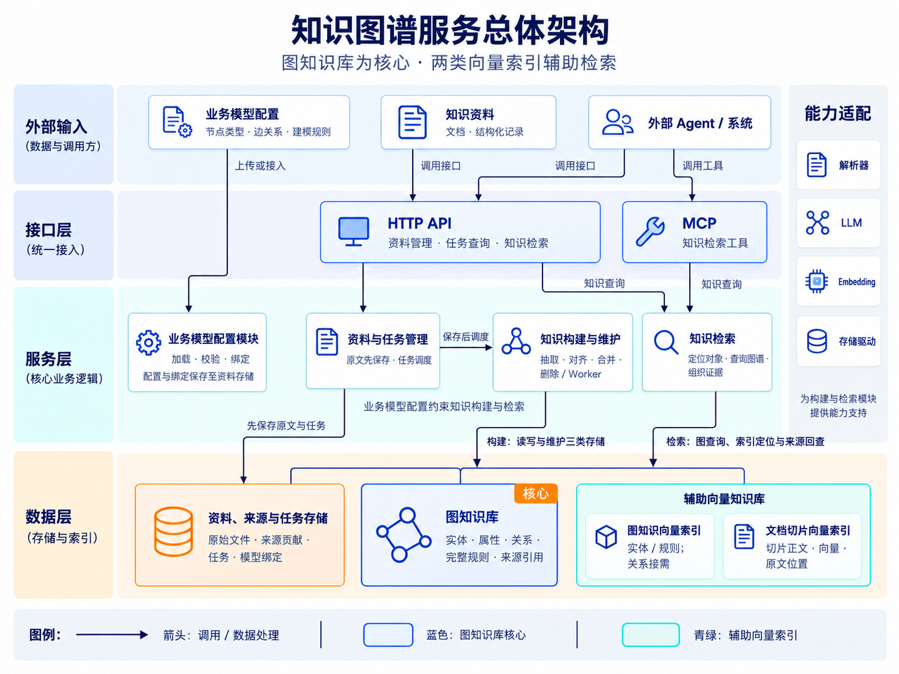
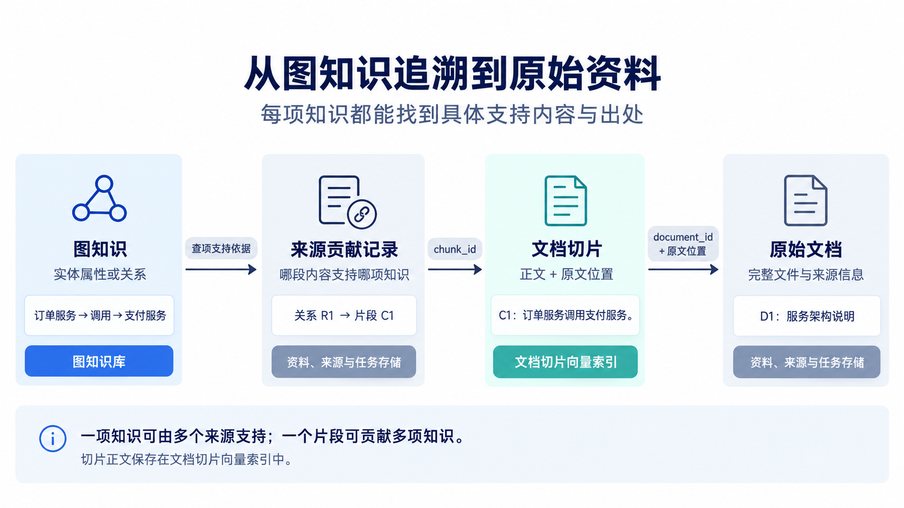
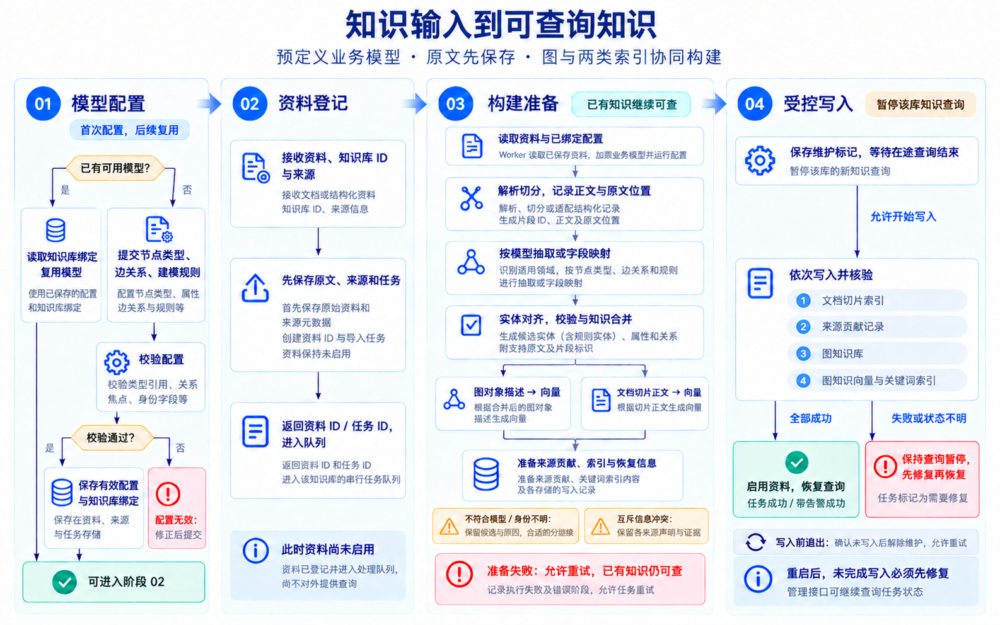
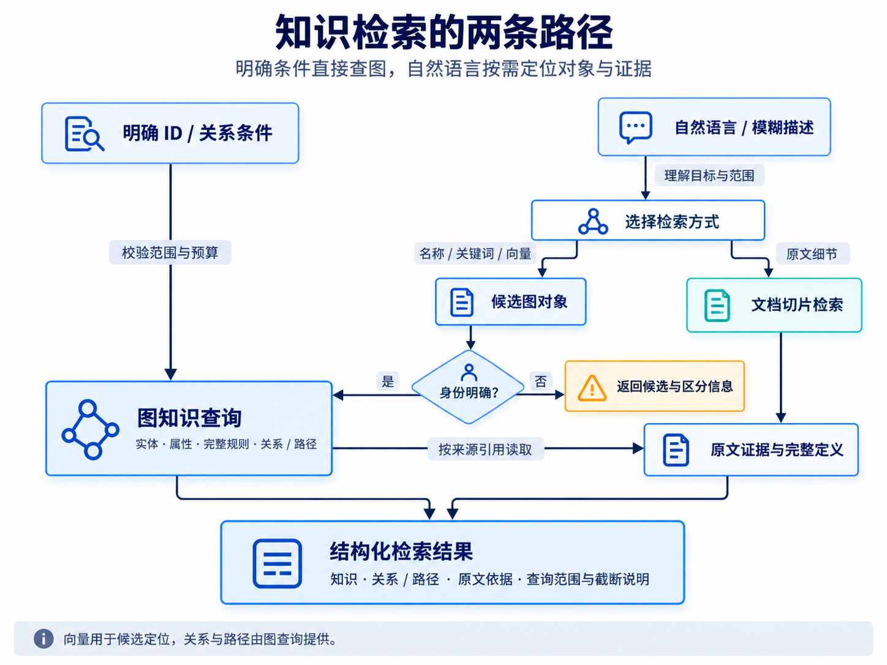

# 知识图谱项目架构设计

> 阅读说明：本文记录已定稿的主架构。现有环境见[运行指南](../03-使用与验证/运行指南.md)，已完成的基础检查见[工程验证与限制](../03-使用与验证/工程验证与限制.md)。代码分层、物理数据结构和具体实现机制见[实施设计](实施设计.md)。


定稿日期：2026 年 11 月 1 日  
状态：主架构已定稿，核心功能已按实施设计分层实现并连接真实存储与模型；机制、恢复与专项边界已有通过证据，公开合同质量及人工验收仍有未完成项，见[评测说明与结果](../03-使用与验证/评测说明与结果.md)。

## 1. 架构概览

本项目构建一套可配置的知识图谱构建、维护与检索服务。**图知识库负责组织和提供知识，向量索引辅助定位图对象与文档证据，对外同时提供 MCP 和 HTTP API。**

业务接入方预先提供节点类型、边关系和建模规则。系统根据这份配置处理输入资料，形成带来源依据的实体、属性、关系和规则知识。通用内核负责处理机制，具体业务通过模型配置和数据适配接入。

### 1.1 核心设计决定

| 方面 | 确定的设计 |
|---|---|
| 项目定位 | 提供知识构建、维护和检索能力，服务外部 Agent 与系统 |
| 核心知识载体 | 图知识库，保存当前实体、属性、关系、完整规则和来源引用 |
| 辅助检索 | 分为图知识向量索引、文档切片向量索引；名称和编码等支持关键词或精确匹配 |
| 模型输入 | 外部明确提供节点类型、边关系和建模规则，系统加载、校验并绑定知识库 |
| 资料入口 | 上传或接入后，首先保存原始资料、来源信息和处理任务 |
| 切片保存 | 切片正文、向量及原文位置由文档切片索引共同管理，不另建独立的切片正文库 |
| 知识维护 | 资料驱动；按来源撤回贡献并重建共享知识，更新采用删除成功后重新导入 |
| 对外出口 | MCP 与 HTTP API 共用检索服务；HTTP API 另外提供资料管理和任务查询 |
| 首版部署 | 模块化单体加后台 Worker；同一知识库的维护任务串行执行 |

### 1.2 系统边界

本项目负责模型配置加载、资料接入、解析切分、知识抽取、实体对齐、建图、索引、来源追溯、删除重建和知识检索。LLM 可以参与分类、抽取、辅助对齐及检索规划。

外部 Agent 负责面向最终用户组织回答、执行业务计算、问数和业务操作。本项目可以保存计算口径、公式和完整规则定义，并将其交给调用方，但不执行这些业务计算。

首版只维护当前知识，不提供知识历史查询、整库发布版本或历史回滚。不提供直接修改图中实体和关系的管理入口，纠正知识通过修正来源资料并重新导入完成。自动生成业务模型、算法社区、复杂权限平台和完整管理后台不属于首版核心范围。

## 2. 整体架构与层次

系统分为接口层、服务层和数据层，解析器、LLM、Embedding 及存储驱动作为适配能力供服务层调用。以下划分描述逻辑职责，不要求每个模块独立部署，也不要求每类逻辑存储使用独立数据库产品。

### 2.1 总体架构图

图中卡片表示逻辑模块与存储区域，箭头表示调用或数据处理；蓝色突出图知识库，青绿色表示辅助向量索引。构建与检索访问数据层中的三类存储。资料接入后先保存，再由后台任务处理。



关键词和精确匹配能力附着于图对象、切片及相应索引，不另画成独立知识库。

### 2.2 各层职责

| 层次 | 包含内容 | 职责边界 |
|---|---|---|
| 接口层 | HTTP API、MCP 适配器 | 接收请求、校验接口参数、调用服务、适配返回格式；共用业务逻辑 |
| 服务层 | 模型配置、资料任务、构建维护、知识检索 | 编排业务流程，落实建模规则、来源管理、检索和更新约定 |
| 数据层 | 资料来源任务存储、图知识库、辅助向量知识库 | 保存各类数据，并提供对应的读写和查询能力 |
| 能力适配 | 解析器、数据源适配器、LLM、Embedding、存储驱动 | 屏蔽具体供应商和产品差异，供服务模块调用 |

Worker 是后台任务的执行方式，不是新增业务层。首版可以与在线服务使用同一代码仓库，在线请求和后台任务共用模型定义、数据标识及核心逻辑。

## 3. 输入及业务模型配置

### 3.1 三类输入

| 输入 | 提供者 | 直接输入的内容 | 使用阶段 |
|---|---|---|---|
| 业务模型配置 | 业务接入人员 | 节点类型、属性定义、边关系、建模规则；领域目录等补充配置 | 首次接入时加载，之后每次导入和查询复用 |
| 知识资料 | 用户或数据源适配器 | 文档、文本或结构化记录，知识库 ID，来源信息，可选领域提示 | 每次导入 |
| 系统运行配置 | 开发、部署人员 | 解析器、切分参数、抽取 LLM、Embedding 模型、查询预算等 | 应用运行和任务执行 |

业务模型配置首版通过 YAML／JSON 文件提供。系统接收已经明确的结构化配置，不把“从样例文档自动推导节点和边类型”作为建库主流程。接入人员准备配置时可以参考业务资料，但这是系统外的配置准备工作。

配置文件是提交载体。校验后的当前有效配置及知识库绑定记录，保存在“资料、来源与任务存储”的知识库元数据中，由模型配置模块统一读取。修改本地配置文件不会直接改变在线模型，须显式加载并按模型调整流程应用。

### 3.2 业务模型包含什么

| 配置项 | 内容 | 示例 |
|---|---|---|
| 节点类型 | 类型名称、含义、属性、必填要求、字段类型 | `Service`、`Team`；服务包含 `app_id`、名称、别名 |
| 边关系 | 关系名称、方向、允许连接的节点类型、关系属性 | `CALLS: Service → Service`；`OWNED_BY: Service → Team` |
| 身份与合并规则 | 可靠身份字段、命名空间、匹配及合并条件 | 服务按应用标识对齐，不因显示名称相同直接合并 |
| 结构与校验规则 | 属性约束、端点要求、单值或互斥条件 | 某属性只允许一个明确值；边必须连接已确定的实体 |
| 抽取与映射规则 | 抽取说明、示例、字段映射要求 | 从明确表述中抽取调用关系；将来源字段映射到 `app_id` |
| 补充配置 | 领域目录、层级、术语和类型适用范围 | 交易域、支付域；同一实体可以属于多个领域 |

“建模规则”与“规则知识”分开处理：前者指导如何建图；退款条件、指标口径、公式及其适用条件等属于后者，按照业务模型保存为规则节点、属性或关系，供外部系统读取。

需要独立检索和完整读取的规则，建模为一种实体类型，使用实体 ID。作为实体属性或关系条件保存的规则内容，随所属实体或关系完整读取，不额外分配独立规则 ID。候选抽取中的“实体”也包括模型已定义的规则实体。

### 3.3 类型与实例的区别

下面的服务依赖场景同时用于架构说明和确定性机制评测。它是明确构造的服务目录资料，不能代表企业语料准确率；真实文本效果另用公开合同小样本记录。

```text
模型配置：
  节点类型：Service、Team
  边关系：CALLS、OWNED_BY
  身份规则：Service 按 app_id 对齐；Team 按 team_code 对齐

文档中的内容：
  订单服务（order-service）调用支付服务（payment-service）。
  支付服务由支付团队（pay-team）负责。

构建结果：
  具体实体：订单服务、支付服务、支付团队
  具体关系：订单服务 CALLS 支付服务
            支付服务 OWNED_BY 支付团队
```

系统校验配置中的类型引用、关系端点、身份字段及领域结构，通过后将其绑定到知识库。资料导入只需指定知识库，便可读取已绑定配置。领域用于知识组织与查询范围，不自动代表权限或物理数据库边界。

## 4. 服务模块设计

### 4.1 业务模型配置模块

**输入：** 外部提供的节点类型、边关系、建模规则和领域补充配置。  
**输出：** 知识库绑定的可用模型定义、配置校验结果。

模块负责加载、校验、绑定和读取模型，为构建模块提供抽取与身份约束，为检索模块提供类型说明和查询约束。`describe_model` 从这里读取定义。

首版不在普通资料导入过程中自动增加节点类型或边类型。配置不能表达的内容保留为原文和未入图候选。修改配置后必须明确触发受影响知识的重建，不能直接让新配置解释未经处理的旧图数据。

### 4.2 资料与任务管理模块

**输入：** 资料导入、资料删除、任务查询或重试请求。  
**输出：** 资料 ID、任务 ID、处理状态、结果统计和错误或告警信息。

模块首先保存原始资料、来源元数据和任务，然后调度 Worker。它管理资料与任务的生命周期，不承担知识抽取，也不自行维护一套实体和关系数据。

资料刚保存时尚未启用，只有导入成功或带告警成功后才参与当前知识库；删除成功后退出。资料的启用状态与某次任务的执行状态分别记录，不能因为文件已经保存，或某次后续任务失败，就改变它是否参与当前知识库。

上传与删除是明确的独立操作。同名文件、相似文本或较晚上传时间不触发自动替换。重复请求通过显式幂等键、请求字段直接比较、必要的原文逐块字节比较以及数据库唯一约束保持幂等；恢复复用已持久化的随机对象 ID。

### 4.3 知识构建与维护模块

**输入：** 已保存资料、知识库业务模型、运行配置、已有图知识及来源贡献。  
**输出：** 当前图知识、两类向量索引、来源贡献记录和任务结果。

模块由 Worker 执行，内部包含以下处理步骤。它们是同一模块中的能力，不要求各自成为微服务。

| 内部能力 | 处理动作 | 输出 |
|---|---|---|
| 资料预处理 | 解析、切分，记录原文位置；适配结构化记录 | 切片正文、片段 ID、文档 ID、来源位置 |
| 领域识别与上下文组织 | 结合来源提示、领域定义和内容选择抽取范围 | 适用领域、类型和规则；保留跨域信息 |
| 候选知识提取 | 按模型抽取，或按结构化字段映射 | 候选实体、属性、关系及支持原文 |
| 身份对齐与校验 | 匹配已有对象、分配 ID、检查字段与关系端点 | 可采用知识、未采用候选及原因 |
| 来源贡献与知识合并 | 保存单个来源的贡献，依据当前来源整理属性和描述 | 合并后的实体与关系、冲突信息、来源关联 |
| 索引维护 | 生成语义表示，写入、刷新或删除索引记录 | 图知识索引、文档切片索引及关键词索引 |
| 删除与重建 | 撤回指定资料贡献，重建受影响的共享知识 | 清理后的当前图及同步后的索引 |

实体对齐优先使用模型声明的业务标识。名称、别名和语义相似度可以寻找候选，但不能单独证明身份相同。无法确定的候选及依赖它们的关系暂不进入已采用图知识。

合并后的实体描述只能依据当前来源生成。完整规则必须保存必要的定义、条件和适用范围，不能仅用检索摘要代替。

### 4.4 知识检索模块

**输入：** 自然语言、关键词、对象 ID、类型或领域过滤，以及关系查询条件。  
**输出：** 实体、属性、完整规则、关系或路径、原文片段、来源引用，以及歧义、冲突和截断说明。

模块负责选择检索方式、定位候选对象、执行受约束图查询、回查证据和组织结构化结果。模型说明读取、实体搜索与消歧在该模块中实现，不再拆成独立系统层。

明确 ID 或关系条件可以直接进入图查询。自然语言需求按需使用名称、关键词和向量定位对象，再读取图知识和关联证据。向量相似度只用于候选排序，不能证明关系成立；原文中未完成建模的内容作为文档内容返回，不冒充已采用图事实。

### 4.5 HTTP API 与 MCP 适配器

HTTP API 面向外部系统和需要直接调用接口的 Agent，提供知识检索、资料导入与删除、任务状态和重试入口。MCP 首版主要提供知识检索工具，通过工具说明和参数定义帮助 Agent 使用能力。

两个适配器调用同一服务层，保持相同的对象 ID、查询范围、证据和错误语义。接口参数和返回格式可以适配各自协议，不复制两套检索逻辑。模型配置首版使用文件加载，不要求同时建设配置管理界面。

### 4.6 能力适配

解析器负责格式转换和位置映射；数据源适配器负责来源标识和字段映射；LLM 负责受模型约束的语言处理；Embedding 负责将选定文本转换成向量；存储驱动负责具体读写和查询。

业务类型、关系名称和身份规则来自业务配置，不写死在适配器或通用流程中。模型名称、维度和调用参数属于运行配置，不与业务模型定义混用。

## 5. 数据对象与存储归属

### 5.1 主要对象

| 对象 | 核心内容 | 主要存放位置 |
|---|---|---|
| 业务模型定义 | 节点类型、属性、边关系、建模规则、领域定义 | 配置文件用于提交；有效配置及绑定保存在资料、来源与任务存储的知识库元数据中 |
| 资料 `Document` | 资料 ID、原始内容地址、来源、字节长度、启用状态 | 资料、来源与任务存储 |
| 文档切片 `Chunk` | 片段 ID、正文、文档 ID、原文位置、检索元数据 | 文档切片向量索引 |
| 实体 `Entity` | 实体 ID、类型、名称、别名、属性、描述、领域归属 | 图知识库 |
| 关系 `Relation` | 关系 ID、起点、终点、类型、条件及来源引用 | 图知识库 |
| 规则知识 `Rule` | 完整定义、条件和相关对象；独立规则实体使用实体 ID，附属规则内容通过所属对象定位 | 按业务模型表达在图知识库中 |
| 来源贡献 `Contribution` | 来源片段对实体属性、描述或关系提供的具体内容和支持 | 资料、来源与任务存储；图中保留关联引用 |
| 图知识向量记录 | 对象 ID、对象类型、检索文本或其引用、向量及过滤元数据 | 图知识向量索引 |
| 处理任务 `Job` | 任务 ID、操作对象、阶段、结果、告警、恢复所需记录 | 资料、来源与任务存储 |

实体是图中的具体业务对象。解析、切分、抽取、对齐、合并、向量化和删除是动作；任务、切片和向量记录是系统数据对象，不要求全部作为业务图节点。

### 5.2 三类存储的职责

**资料、来源与任务存储**保存原始文件、文档记录、完整的来源贡献关联、任务状态，以及知识库的有效模型配置和绑定信息。它提供资料回看、删除影响分析和重建依据，不另存一份完整的当前实体关系主库。

**图知识库**保存和提供当前采用的结构化知识。属性事实可以表达为节点属性，关系事实可以表达为带 ID 的边；两者都关联来源。节点类型和属性结构由业务模型决定。

**辅助向量知识库**保存两类检索记录。文档类记录共同保存正文、向量和出处；图知识类记录指向图中的对象，图对象的完整知识仍从图知识库读取。向量数据之外的正文和元数据必须支持按 ID 读取及按资料清理，不能只提供相似度搜索。

### 5.3 两类向量索引

| 对比 | 图知识向量索引 | 文档切片向量索引 |
|---|---|---|
| 向量化对象 | 实体、规则等对象的名称、别名、定义、合并描述；按需包括关系描述 | 原文切片正文 |
| 对象标识 | `entity_id`（包括独立规则实体）或 `relation_id` | `chunk_id`、`document_id` |
| 查询用途 | 将自然语言定位到图对象，再读图、查关系或路径 | 查找细节、原文证据和未结构化内容 |
| 更新依据 | 图对象的当前内容变化 | 切片变化或资料删除 |
| 持久化正文 | 可保存检索文本副本；完整知识以图为准 | 保存切片正文及原文位置 |

两类索引可以位于同一个向量存储产品中，并通过集合、表或对象类型区分。当前在 Qdrant 中分别保存图对象向量、原文切片和代表向量，具体物理结构见[实施设计](实施设计.md#46-qdrant-集合与向量共享)。关系向量不是首版必选项，只有需要直接按自然语言召回关系事实时才建立。

这里采用文本 Embedding 辅助检索。图的连接、方向和多跳路径由图查询处理。每个检索通道的内容向量和查询向量必须使用兼容的模型与维度；调整 Embedding 配置时重建相应索引，并保留正文和图知识。

### 5.4 来源关联与标识



来源贡献记录需保存具体的属性值、描述片段或关系声明及其出处，不能仅记录“某实体出现在某文档”。一个片段可以贡献多项知识，一项知识也可以由多个片段共同支持。删除判断使用完整的贡献关联，不依据实体摘要或被截断的引用列表。

资料 ID 标识一次被管理的资料记录；删除后重新导入产生新的资料 ID。仍然存在的实体按身份规则复用 ID，已经彻底删除的实体重新建立时不承诺沿用原 ID。片段 ID 不得复用给另一段内容。对已删除对象的详情请求返回明确的不存在结果。

## 6. 关键流程 输入资料到可查询知识

### 6.1 流程目标和顺序

业务模型是前置配置，资料是知识内容输入。首次接入时完成配置加载和绑定，以后导入复用已有模型。资料登记成功后才开始解析和知识构建。

| 阶段 | 输入 | 处理动作 | 输出与保存位置 |
|---|---|---|---|
| 0 模型准备 | 外部节点类型、边关系、建模规则 | 加载、校验、绑定知识库；已有模型则读取复用 | 可用业务模型 |
| 1 资料登记 | 原始资料、知识库 ID、来源信息 | 保存原文和元数据，创建并排队任务；资料尚未启用 | 资料、来源与任务存储中的资料和任务 |
| 2 解析切分 | 已保存原文、解析配置 | 提取文本、切分并记录来源位置；适配结构化记录 | 处理中间结果：切片正文、ID、位置 |
| 3 候选提取 | 切片或记录、业务模型 | 识别领域，按类型抽取或字段映射，附支持原文 | 候选实体、属性、关系 |
| 4 对齐与合并 | 候选、已有图知识、当前来源贡献 | 身份对齐、约束校验、保留未采用候选、识别冲突、合并描述 | 待写入图对象与来源贡献 |
| 5 向量准备 | 合并后的对象描述、切片正文 | 分别调用 Embedding，准备关键词索引内容 | 两类待写入向量记录 |
| 6 写入 | 待写入知识、贡献和索引 | 保存恢复记录，暂停知识查询，按计划写入各存储 | 当前图、两类索引、来源贡献 |
| 7 完成 | 写入结果与引用检查结果 | 核验对象和证据引用，启用资料，记录结果，恢复查询 | 成功或带告警成功的任务结果 |

切片准备阶段的内容是任务中间结果，正式正文保存位置是文档切片索引。失败重试可以使用任务检查点或重新读取原文件，检查点不构成额外的切片知识库，成功后可以清理。

### 6.2 输入处理流程图

下图按“模型配置、资料登记、构建准备、受控写入”展示关键流程。首次配置分支不代表每次上传都重新配置模型；向量计算依据已合并好的待写入知识，可在正式写库前完成。完整活动分支保留在 PlantUML 源文件及其 SVG 渲染图中。

可编辑图源：[知识输入处理流程.puml](<../assets/diagrams/知识输入处理流程.puml>)  
PlantUML 原始渲染图：[知识输入处理流程.svg](<../assets/diagrams/知识输入处理流程.svg>)



### 6.3 抽取与校验结果的处理

符合模型且身份明确的知识入图。不符合模型、缺少必要身份依据或无法确认端点的候选，连同原文引用及原因保留在任务结果中；合法部分仍可继续构建。原文切片保留检索能力，任务明确报告哪些内容没有入图。没有生成图知识时也要如实报告，不能只用“成功”掩盖覆盖不足。

对模型声明为单值或互斥的信息，不同来源发生冲突时保留各自的声明和证据，标注冲突。默认不按上传时间覆盖，也不让 LLM 无依据选出唯一值。检索结果返回冲突项及依据，供调用方判断。

解析、模型调用、Embedding 或存储失败属于执行失败，与候选知识未通过校验不同。执行失败进入任务恢复流程，不能以“有告警成功”代替。

### 6.4 一个完整示例

假设模型已定义 `Service`、`Team`、`CALLS`、`OWNED_BY` 及身份字段。上传资料包含：

> 订单服务（order-service）调用支付服务（payment-service）。支付服务由支付团队（pay-team）负责。

处理结果应能够对应到以下对象：

| 位置 | 示例结果 |
|---|---|
| 资料存储 | 原文件 `D1`、来源信息、导入任务 `J1` |
| 文档切片索引 | `C1` 的正文、文档向量、`document_id=D1` 和原文位置 |
| 图知识库 | 订单服务、支付服务、支付团队三个实体，以及调用、负责两条关系 |
| 图知识向量索引 | 各实体的名称、定义和描述对应的向量，指向实体 ID；关系向量按需生成 |
| 来源贡献记录 | `C1` 对实体身份、名称以及两条关系的分别支持 |

图中的“订单服务调用支付服务”可以通过来源贡献定位到 `C1`，再通过 `D1` 查看原文件。向量命中只负责定位，关系本身从图知识库读取。

## 7. 查询与对外接口

### 7.1 检索接口

| 能力 | 主要输入 | 主要输出 | 读取位置 |
|---|---|---|---|
| `describe_model` | 知识库及可选领域 | 节点类型、边关系、字段和规则说明 | 已绑定业务模型 |
| `search_knowledge` | 文本、目标对象类型、领域或其他过滤条件 | 候选对象、ID、相关摘要及匹配信息 | 图查询、关键词索引、两类向量索引 |
| `get_knowledge` | 对象类型和已有 ID | 完整实体、规则、关系或切片及来源 | 图知识库或文档切片索引，关联来源存储 |
| `query_graph` | 实体 ID、关系类型、方向、查询方式和预算 | 邻居、依赖、路径及对应证据 | 图知识库和来源关联 |
| `retrieve` | 自然语言需求、知识库、可选范围 | 相关知识、路径、原文和范围说明 | 检索模块按需组合上述能力 |

Agent 不需要预先知道实体 ID。可以从 `search_knowledge` 或 `retrieve` 获得 ID，再调用详情或图查询；也可以只调用 `retrieve` 获取一次组合检索结果。`describe_model` 为调用方提供明确模型信息，不是每次自然语言检索的强制前置步骤。

### 7.2 两条查询路径



图查询处理方向、关系类型、跳数和路径。向量不承担精确集合查询：查询“全部调用者”时，实体确定后由图查询枚举受约束范围内的结果，不能把相似度 Top-K 当成完整集合。

图中未找到的知识可以由原文检索补充，但结果需区分已采用图知识、冲突声明与文档内容。没有查到关系不等于证明现实中不存在该关系。

### 7.3 统一返回约定

结果按对象 ID 组织，包含相关实体和事实、完整规则、关系或路径、证据片段及出处。对路径提供各条边的依据，不能只给终点实体介绍。必要时同时返回歧义候选、冲突信息、未找到说明、实际查询范围和截断原因。

MCP 与 HTTP 使用相同核心结果。最终回答组织和业务计算由外部 Agent 执行。本项目的语义理解和检索规划仅服务于知识定位与证据组织。

## 8. 删除、重新导入与模型调整

### 8.1 按资料删除

删除前，根据完整来源贡献记录确定受影响对象，并准备剩余来源下的新属性、描述和索引。随后按与导入相同的受控写入机制应用删除。

1. 查出资料的切片、来源贡献、关联实体和关系。
2. 撤回该资料提供的属性、描述和关系支持。
3. 删除不再有来源支持的关系；保留并重建仍有其他来源支持的关系。
4. 根据剩余贡献重建实体属性、描述和冲突状态。实体已无剩余贡献、也不被保留关系引用时，再清理实体。
5. 刷新受影响图对象的向量；删除该资料的文档切片记录及相关索引。
6. 核验并提交删除结果，恢复查询。原文件及旧检查点清理完成后，删除任务报成功。

删除过程中不能保留仅由已删资料提供的旧摘要或属性。关系和实体的索引随最终保留内容更新。

例如，资料 A 和 B 都支持同一调用关系。删除 A 后，关系保留，来源变为 B；只有剩余支持全部消失时才删除该关系。关系退出当前图表示当前资料不再支持它，不代表系统断言现实中该关系不存在。

### 8.2 资料更新

```text
提交删除旧资料的请求
    → 查询删除任务，确认成功
    → 导入新资料
    → 查询导入任务，确认处理结果
```

删除和导入是两个独立任务，不建立前后文档的版本关系。旧资料删除后，新导入失败不会自动恢复旧知识。调用方可以重新导入保留在其来源系统中的资料。

### 8.3 业务模型调整

修改节点类型、边关系、身份规则或抽取规则后，需要明确重建受影响知识。首版不做存量图的自动复杂迁移；无法可靠确定影响范围时，从当前已启用资料的原始内容重建整个知识库的图和索引。

重建任务明确记录资料 ID 集合，默认只包含已经成功或带告警成功导入、且尚未删除的已启用资料。排队中、准备失败和已经删除的资料不因原文件存在而自动参与重建；存在未完成写入的任务时先修复，再确定重建范围。

模型调整与重建作为同一维护过程安排：在新模型对应的图和索引准备好之前，不把不兼容的新模型用于在线解释旧知识；实际切换及重建写入期间暂停知识查询。模型配置不保存成对外可查询的知识历史版本。

## 9. 一致性、失败与任务恢复

### 9.1 同一知识库串行维护

导入、删除和重建任务在同一知识库内串行执行，使准备期间读取的当前图和来源贡献保持稳定。首版已采用全局单 Worker；需要修复的库阻塞本库后续维护，其他库仍可继续调度。

业务模型也不能在任务中途被随意替换。每个任务使用开始处理时确认的配置，配置调整与维护任务一起调度。

### 9.2 准备与写入分开

准备阶段执行解析、抽取、对齐、合并计算和 Embedding，当前知识保持可查询。完成准备后，保存待写入对象 ID、删除目标和任务恢复信息，持久化“维护中”标记，暂停该库新知识查询并等待在途查询结束，再执行跨存储写入。

同库维护任务按顺序发布，导入和删除的差量按存储并行写入。图、索引、来源贡献及引用核验全部成功后，提交资料可见状态并恢复查询。删除任务随后清理原文和旧检查点。

### 9.3 失败行为

| 情况 | 任务处理 | 查询行为 |
|---|---|---|
| 准备阶段执行失败 | 记录错误，保留资料，允许重试 | 已有知识继续可查 |
| 部分候选不符合模型 | 保留候选与原因，继续处理可采用内容 | 完成后返回已采用知识及必要告警 |
| 正式写入前无法取得维护条件 | 确认尚未修改正式知识数据时，解除本任务的维护标记，保持排队或记录可重试原因 | 保持或恢复已有知识查询 |
| 已经写入部分数据后失败 | 标记需要修复，按同一任务继续应用或重建 | 保持该库知识查询暂停 |
| 服务重启时发现未完成写入 | 读取持久化维护标记和任务记录，先恢复 | 修复完成前不开放知识查询 |

任务重试沿用已分配的对象 ID 和来源关联标识，以覆盖或去重方式写入，避免重复实体、重复关系和重复贡献。管理接口仍可查询任务状态；知识查询返回明确的维护中信息。

只有能确认本任务尚未修改图、来源贡献或可检索索引时，才允许在放弃写入后解除维护标记。若已经写入部分数据，或无法确定是否发生过写入，继续暂停查询并进入修复流程。

### 9.4 首版任务结果

任务至少区分排队、准备、写入、成功、带告警成功、准备失败和需要修复。结果包含资料 ID、采用和未采用知识数量、索引处理结果、告警原因及错误阶段。

“带告警成功”用于未采用候选或业务冲突等内容问题，不用于掩盖存储未同步、索引缺失或恢复未完成。原始文件即使保留，也不能据此把半完成的图和索引对外宣布为可用。

## 10. 首版落地范围与验收

### 10.1 落地组织

采用模块化单体与后台 Worker。服务层围绕业务模型、资料任务、知识构建维护、检索四类职责组织代码；接口层保持薄适配；解析、模型调用与存储操作通过适配层接入。

首版已实现文档知识构建、结构化字段映射、来源维护与五个共享检索出口。正式项目使用独立 `.venv`，依赖由 `requirements.lock` 固定；当前使用 PostgreSQL、Neo4j 和 Qdrant。历史业务案例验证了 API/Worker 以及通过 OpenRouter 接入的 LLM 与 Embedding。具体结构和运行机制见[实施设计](实施设计.md)，实际检查与合同缺口见[评测说明与结果](../03-使用与验证/评测说明与结果.md)。这不代表合同语义全部通过或已完成生产容量验证。

### 10.2 核心验收场景

| 场景 | 应验证的结果 |
|---|---|
| 模型输入 | 节点、边和规则来自明确配置；错误配置被识别；普通导入不暗中改模型 |
| 文档导入 | 原文先保存，任务可查询；实体、关系和切片可追溯到原文件 |
| 同名与身份对齐 | 可靠业务标识驱动合并；同名异义对象不会被强行合并 |
| 自然语言找对象 | 不预先提供 ID，仍能定位候选对象并进入图查询 |
| 关系及路径查询 | 返回方向正确的关系与路径，并可读取各条边的来源依据 |
| 文档补充检索 | 能找回原文细节，且与已采用图事实在结果中区分 |
| 删除独有知识 | 该资料独有的关系、描述和索引被清理，不残留在实体摘要中 |
| 删除共享来源 | 其他资料仍支持的实体和关系被保留，描述、来源和向量同步更新 |
| 非法候选与冲突 | 未采用内容及原因可见；互斥声明保留来源，任务和查询不掩盖问题 |
| 写入失败恢复 | 部分写入时暂停知识查询，任务重试后恢复，重复执行不产生重复知识 |
| 业务适配 | 接入第二类业务时主要调整模型配置和来源适配，核心流程能够复用 |

### 10.3 已落实的验证输入与剩余边界

项目提供服务目录 CSV/JSON、两份 CUAD 短合同及一份完整长合同。模型默认通过 OpenRouter 使用 GLM 5.3 与 Gemini Embedding 2（3072维），运行参数和验证预算独立配置。公开小样本用于暴露抽取与维护问题，不替代企业业务资料。企业验收问题、人工标注、质量阈值、扫描或复杂表格适配，以及生产负载和容量仍待按实际业务确定；这些输入不改变本文的主架构。

## 11. 图源与参考材料

总体架构、来源关联与查询路径保留 Mermaid 图源；输入处理流程保留 PlantUML 图源及 SVG，便于同步修改结构和流程。

| 图 | 图示 | 可编辑图源 |
|---|---|---|
| 总体架构 | [图01-总体架构.png](<../assets/diagrams/图01-总体架构.png>) | [总体架构.mmd](<../assets/diagrams/总体架构.mmd>) |
| 来源关联 | [图02-来源关联.png](<../assets/diagrams/图02-来源关联.png>) | [来源关联.mmd](<../assets/diagrams/来源关联.mmd>) |
| 知识输入处理 | [图03-知识输入处理.png](<../assets/diagrams/图03-知识输入处理.png>) | [知识输入处理流程.puml](<../assets/diagrams/知识输入处理流程.puml>) |
| 知识检索路径 | [图04-知识检索路径.png](<../assets/diagrams/图04-知识检索路径.png>) | [知识检索路径.mmd](<../assets/diagrams/知识检索路径.mmd>) |

全部图示及图源见[图示索引](../assets/diagrams/README.md)。

- [输入处理 PlantUML 源文件](<../assets/diagrams/知识输入处理流程.puml>)。
- [输入处理 SVG 预览](<../assets/diagrams/知识输入处理流程.svg>)。
- [知识图谱与 RAG 学习笔记](<../01-学习与调研/知识图谱与RAG学习笔记.md>)整理相关概念与取舍；本项目的系统边界和维护方式以本文为准。
- 按文档撤回贡献、重建共享知识的维护方式参考 [LightRAG 官方说明](https://github.com/HKUDS/LightRAG/blob/main/docs/ProgramingWithCore.md#delete-by-document-id)。本文的切片存放、服务边界和一致性处理是本项目的设计决定，不等同于完整采用 LightRAG 的内部实现。
- 输入流程的可编辑图源采用 [PlantUML 活动图语法](https://plantuml.com/activity-diagram-beta)，可按其[命令行说明](https://plantuml.com/command-line)在本地渲染。
