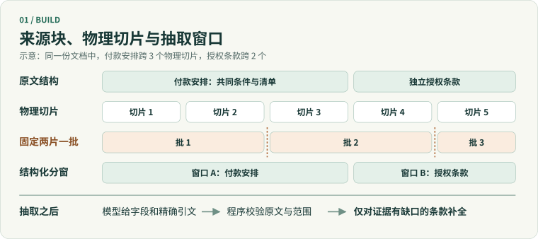
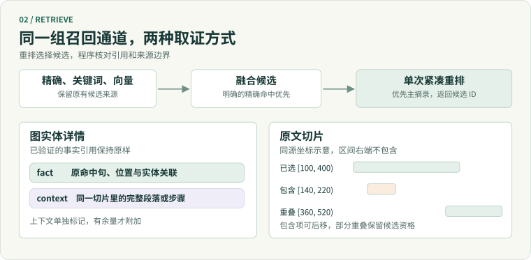
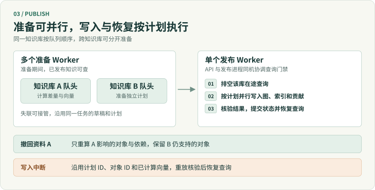

# 迭代优化设计

整理日期：2026 年 11 月 8 日

本轮从 `df1ccd8d` 开始，包含该提交及之后合入主线的改动，截止 `8e0a5ce`。完整版本评测以 `df1ccd8d` 的父提交 `ed87884` 为旧版。评测的样本、配置和逐题结果见[评测说明与结果](../03-使用与验证/评测说明与结果.md)。

服务从资料中构建带出处的实体、关系和规则。要理解这轮改动，可以沿一次资料导入和查询来读：先确定要抽取什么，再决定模型能看到哪些原文，最后判断查询返回是否足以支持结论。维护部分说明资料撤回后如何重算、发布和恢复。

| 改造 | 对应提交 | 调用方能观察到的变化 |
| --- | --- | --- |
| 条款粒度与覆盖 | `df1ccd8d`、`2cec5c5` | 共同条件与清单能作为完整规则保存，独立义务保留各自身份，标题对应实际正文。 |
| 局部更新与向量复用 | `5d3e783`、`0abcbbd`、`3b974c0` | 导入、删除按来源生成差量计划。符合条件的文本复用向量数值，仍可独立回查和撤回来源。 |
| 解析、发布与检索基础 | `3b974c0` | 支持 Word 正文与常规表格，按文档结构切片。准备与发布可分开调度，文件清理移到停读窗口外。 |
| 构建策略与取证 | `6edb6ea`、`8e0a5ce` | 保留全文与结构化分窗。以核验过的摘录重排，图实体与原文各自补齐需要的证据。 |

## 1. 文档结构与业务语义分开处理

### 1.1 先确定一条规则，再给它命名

旧合同模型倾向按编号和换段拆条款。一份分期付款安排可能拆成总说明和多条只剩日期、金额的子项。独立检索任一子项时，付款主体、触发条件或适用例外可能已经不在该实体的正文里。

`df1ccd8d` 同时修改通用抽取提示和合同业务模型。先根据正文确定条款覆盖范围，再使用实际统领正文的原文标题。没有独立标题时，从这段正文开头取一段有区分度的连续原文。共同约束下的分期、费率或选项保留为一条规则。

`2cec5c5` 进一步区分了列举项和可独立适用的规则。只枚举同一规则取值的子项随总说明保存。具有各自义务、触发条件或结果的子项分别入图，并携带适用的共用条件。提示要求沿原文顺序检查靠后的章节及无编号段落，减少只抽取醒目标题的情况。相同规则多次出现时保留各处支持引用。

### 1.2 让解析后的内容仍能回到原文

Markdown 和 Word 按可识别的标题层级保留章节路径。新增的 Word 解析沿正文顺序读取段落与常规表格，分别保留段落或单元格的位置。解析过程中用于拼接显示的分隔符标为格式内容。文本定位继续沿 `source_spans` 回查到原文或原字段。

模型中的字符串属性可以声明 `source_mode: literal`。这类字段由程序根据模型给出的来源选区恢复正文，再核对位置、顺序和可见范围。字段文本随原文产生，模型负责选择证据。规则中的条件、例外和引用各自保留依据，详情可以回查被采用的正文来自哪里。

### 1.3 缺少身份字段时，按明确证据对齐

默认仍以业务身份识别实体。候选缺少完整身份时，只有业务模型显式配置 `identity_match`，才尝试用有原文依据的稳定字段或明确的别名等价声明定位已有实体。稳定字段须单值、可查询，并与显示名称、别名分开。命中结果还受知识库、类型和资料身份范围约束。证据缺失或命中多个对象时，候选保持未采用状态并记录原因。

例如同名服务可能属于不同系统。系统编码等稳定字段可以把当前提及对齐到唯一服务。在身份字段不完整的情况下，同名或文本相似只作为线索，来源记录各自保留。被采用的身份依据随来源贡献保存，后续撤回资料时还能定位依赖这条依据的对象。

实现见[合同模型](../../examples/contracts/model.yaml)、[Word 解析](../../src/knowledge_graph/adapters/parsers/word.py)、[逐字字段校验](../../src/knowledge_graph/services/construction/literal.py)与[实体对齐](../../src/knowledge_graph/services/construction/alignment.py)。

## 2. 物理切片和模型抽取窗口分别规划

索引切片用于定位和返回原文，大小适合向量检索。抽取窗口决定模型在一次调用里能看到哪些条件、正文和相邻条款。把两者绑定为固定片数时，切片中间的边界容易变成模型缺失上下文的位置。

| 构建策略 | 如何组织模型输入 | 适用范围 |
| --- | --- | --- |
| `whole` | 完整请求能装入预算时保留全文。超限后按章节和可见来源单元组批。 | 默认策略，适合需要保留全文关系且预算允许的文档。 |
| `structure` | 先用章节、段落和列表组织连续来源块，再按原文顺序组窗。排版被压平时，只在句界、编号和短标题等条件满足时推断行内边界。 | 长文或单次抽取容易漏项时可启用。默认目标为 10,000 个可见原文字符，仍受完整请求的硬预算约束。 |

图中付款安排跨前三个物理切片。固定两片一批会把共同条件和清单拆开，结构化规划优先把该来源块涉及的切片放到同一窗口。窗口变了，最终引用仍映射回原来的切片和字符范围。

### 2.1 模型抽取、程序校验和补全各有边界

1. **抽取**。模型在窗口内给出实体、字段和关系，并用来源单元和精确引文标记依据。临时引用按批次隔离。
2. **校验**。程序检查类型、身份、关系端点和原文坐标。引文要在本次实际可见的来源范围内。格式错误可做一次结构纠正，引用错误按字段修复。
3. **补全**。当已选正文触及同一来源块的未展示续段时，再给模型包含续段的来源。补全应保留原有支持内容，并能指向新增的原文。独立条款和不同资料的条件不在这里合并。
4. **连接**。跨窗口关系单独验证来源和端点，再按业务身份合并。缺少必要证据的内容保留对应原因，供后续检查。

输入超限或输出截断时，结构化策略可缩小窗口。拆分先写入检查点，接管进程从保存的范围继续。成功批次在保留期内可按相同输入、解析、模型、提示和输出契约复用。复用的是已通过校验的响应，引用仍按当前原文重新绑定。模型接口的格式、额度或超时问题由相应阶段显式记录。

完整条款和独立规则能同时保住，额外模型调用也集中在真正需要补全或连接的位置。抽取覆盖、补全和跨窗连接分别计数，方便定位一次构建的主要成本。 [窗口规划](../../src/knowledge_graph/services/construction/extraction_windows.py) · [抽取流程](../../src/knowledge_graph/services/construction/extraction.py) · [引用与补全](../../src/knowledge_graph/services/construction/extraction_grounding.py)

## 3. 保留融合召回，分别设计图实体和原文取证

检索先融合精确匹配、关键词和向量候选。明确身份或名称精确命中时保留融合顺序。限定资料范围时，以选中来源的贡献和切片为准，实体属性与证据也按该范围重新组织。向量相似度提供候选，图中的邻居与路径按明确条件查询。

| 阶段 | 当前设计 | 结果边界 |
| --- | --- | --- |
| 紧凑重排 | 先给候选分配经过核验的主要摘录，再按剩余预算补充。重复摘录共享引用，章节路径单列。模型输出候选 ID。 | 程序只接受本次候选中的 ID。短列表按融合顺序补足，模型超时或响应无效时以告警说明回退。 |
| 图实体详情 | 先返回与事实关联的引文。证据预算有余量时，从同一已核验切片补步骤、示例或完整段落。 | 补充内容标为 `context`，原有事实引用和关联不变。每个详情响应附加上下文最多 2,400 字符。 |
| 原文切片 | 给可核验候选标上来源编号和字符区间，重排时同时选出主项和少量备选。先保留覆盖不同范围的主证据，再用备选补足。 | 只推后完全被已选同源区间包含的片段。部分重叠和不同来源的内容仍可入选。 |

例如同源 `[140, 220)` 被已选的 `[100, 400)` 完全包含，可以后移。`[360, 520)` 仍提供 `[400, 520)` 的新内容，继续参与选择。对于无法证明为同源连续文本的候选，程序保留原有候选语义。

取证不足时可以依次检查三个位置：证据是否已入图，候选是否进入前 K，详情是否返回足够原文。补段解决第三类问题。段落若被物理切片截断，详情保留原有引用，可由原文路线继续取证。这样调用方可以区分已经核验的事实、补充上下文和还需追查的来源。

重排实验试过缩小候选池、增加评分字段和混合证据输出。现有结果支持保留融合召回、单次候选选择和可观测回退。 [候选与范围](../../src/knowledge_graph/services/retrieval/search.py) · [紧凑重排](../../src/knowledge_graph/services/retrieval/rerank.py) · [原文备选](../../src/knowledge_graph/services/retrieval/document_rerank.py) · [实体详情补段](../../src/knowledge_graph/services/retrieval/source_context.py)

## 4. 按来源做差量维护，复用计算结果

`5d3e783` 先把导入和删除的写入范围固定到计划中，后续实现把差量延伸到准备和核验。导入根据新增贡献定位对象。删除按资料读取现有贡献、切片和向量归属，再沿身份依赖与关系冲突组找齐需要重算的对象。当前结果由剩余贡献重新聚合。

例如资料 A、B 都支持同一服务依赖，只有 A 提供属性和部分别名。撤回 A 后，B 仍支持的关系保留，A 独有的字段和对应索引内容撤回。如果 A 是某条身份对齐的依据，还要核对其他来源中依赖它的贡献。删除关系冲突的一方时，相关边的冲突状态也随计划重新计算。

| 操作 | 计划范围 | 核验重点 |
| --- | --- | --- |
| 导入、删除 | 本次受影响的对象、关系冲突组、身份依赖与索引 | 剩余贡献、端点、引用、应删记录及存储总数。 |
| 重建 | 整个知识库的目标快照 | 业务模型、对象和引用在新快照中一致。 |
| 重索引 | 文档和图对象的向量索引 | 按新向量配置核验。图和来源贡献沿用已有结果。 |

### 4.1 复用向量数值，保留各自的来源

`0abcbbd` 加入按输入文本和向量配置复用。命中同点 ID 或可复用候选时，程序仍核对完整文本和配置。这样重新解析得到新的切片 ID，也能在内容相同的情况下复用原向量。

后续加入代表向量与切片归属。同文切片可共用向量，仍各自保留原文位置。近似切片的合并是可选策略，要求向量配置与领域条件匹配，并用事实覆盖判断确认哪一份能够代表另一份。检索按资料范围回到仍有效的切片。若删除的是代表来源，系统重新检查组内剩余成员并建立所需代表。

这样可以减少相同输入的重复计算，同时保留独立引用与撤回能力。 [差量准备与向量复用](../../src/knowledge_graph/services/construction/pipeline.py) · [切片向量归属](../../src/knowledge_graph/services/construction/chunk_vectors.py)

## 5. 将准备与正式发布分开，控制停读和恢复范围

准备期间完成解析、抽取、对齐和向量计算，旧知识继续可查。不同知识库的队头可以独立准备。发布由单个进程协调，同库任务保持顺序。先把计划、固定对象 ID、应写和应删的范围及预期结果保存下来，再排空该库在途查询。

导入和删除按同一计划并行写入图、向量与来源贡献。核验全部通过后，用一次元数据事务提交资料可见性、任务状态与读门禁状态。删除后的原文清理放到锁外，任务状态单独反映清理进度。资料是否可查由发布核验决定。

| 中断位置 | 系统怎样恢复 |
| --- | --- |
| 准备中 | 接管同一库的队头，从归属和配置均匹配的草稿或检查点继续。 |
| 已准备，尚未写入 | 验证计划归属、版本和范围，按队列重新申请发布条件。 |
| 正式写入或核验中 | 继续保持维护状态，按原计划重放。已生成的 ID 和向量随计划复用。 |
| 提交结果未知 | 回查持久化的任务和可见状态，区分已生效的发布和仍需重放的写入。 |
| 发布后清理中 | 新状态已经可查询。删除任务沿原计划继续清理文件。 |

这套设计把耗时较高的准备工作移出停读窗口，让多个知识库的准备可以并行，同时保持正式写入可核验、可恢复。任务与来源元数据统一以 PostgreSQL 持久化。组件配置、进程角色和迁移条件另见[运行指南](../03-使用与验证/运行指南.md)。 [写入与恢复细节](实施设计.md#63-正式写入顺序) · [发布执行](../../src/knowledge_graph/services/construction/apply.py)

## 6. 效果与当前取舍

| 设计 | 已观察的效果 | 代价或限制 |
| --- | --- | --- |
| 业务粒度与结构化构建 | 同模型完整重建中，图事实证据覆盖 **12/30 → 29/30**，图实体检索 **1/12 → 11/12**。 | 两版包含各自的合同模型。这组结果说明整套版本的图覆盖收益。结构化方案比一次全文抽取需要更多构建调用。 |
| 按边界分窗与定向补全 | 相对历史固定三片组批，在相同条款正文与图事实覆盖下，构建模型调用 **84 → 14 次**。 | 长文中仍可能有需要跨窗回查的引用。全文优先和结构化构建保留不同适用范围。 |
| 实体详情补段与原文备选 | 固定实体候选的公开长文回放，完整覆盖 **6/17 → 11/17**。原文重排可以用来源区间处理重复证据。 | 补段增加返回文字。固定图的完整检索对照有一题回退，原文重排的覆盖收益较小且有波动。 |
| 差量发布与恢复 | 变更范围、计划重放、读写门禁和来源隔离有独立回归或故障用例可检查。 | 生产容量和延迟需按部署规模另行测量。 |

主线采用原融合召回、紧凑重排和独立的两条取证路线。共享证据组装的配对实验保留在 `experiment/evidence-assembly`，其中公开长文出现覆盖回退。代表性成绩和全部对照见[评测说明与结果](../03-使用与验证/评测说明与结果.md)。
