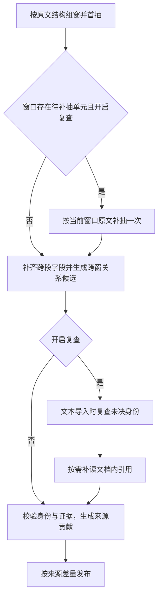

# 迭代优化设计 2026-11-15

本轮集中在构建阶段。上周的全文与结构化分窗、紧凑证据重排和差量发布继续作为系统基础。本轮补齐长文跨窗证据、连续导入中的实体身份判定，以及有预算的构建复查。

## 本轮效果

退货和工资关账各连续导入三份资料。固定登记图与首抽后，复查预算从关闭提高到每份最多 12 次，再到最多 24 次，**关系召回从 6/13 到 8/13，再到 13/13**。服务实体在三档均为 15/15。原文证据覆盖从 7/16 到 9/16，再到 16/16。两档复查分别增加 48 和 87 次语言模型请求。

从 12 档到 24 档新增的 5 条正确关系均来自退货样本。工资关账在 12 档已补齐关系，冷链长手册也在 12 档补齐 2 条跨窗引用。默认预算仍为 0。 [分项成绩、请求开销和验证范围](../03-使用与验证/评测说明与结果.md#6-构建复查与连续导入)

## 主流程

| 阶段 | 本轮处理 |
| --- | --- |
| 结构化首抽 | 统一组窗、绑定来源单元与检验引文，在可见范围内保存候选和出处。必填身份字段缺失时保留可复查的候选。 |
| 窗口补抽 | 开启复查后，模型最多复查一次当前窗口的草稿和原文。程序校验新增候选及证据范围。 |
| 跨窗关系 | 无论复查开关如何，都可依据已验证的实体名和原文生成跨窗候选。两端均在其他窗口时，共用关系原文、端点身份摘要和身份原文。模型判断关系含义和方向。 |
| 文档与身份复查 | 模型可定位并补读引用原文。连续导入时，可根据同篇身份线索和已发布知识，选择复用旧实体、创建新实体或保留待确认。 |
| 对齐与发布 | 程序核验身份及原文，记录冲突、候选问题与来源依赖，然后走现有差量发布。 |

身份复查可以按关键词或语义查询已发布知识。关键词查询返回已确认的旧提及和来源。语义查询组合相关实体与历史原文片段，查询文本由模型组织。当前原文明确支持的身份字段与候选冲突时，程序将冲突反馈给模型继续判断。即使检索没有候选，只要当前资料支持配置中的身份字段，也可以新建。关系的本次贡献须由本次资料支持。

窗口复查、实体身份复查与引用补读共用每份资料的请求预算。检查点保存已完成的模型响应、工具结果和预算用量，恢复时可重放。预算包含语言模型的传输重试与结构纠正。达到上限后记录问题，保留已经取得的合法候选。基础首抽、跨窗连接及语义工具的查询向量单独计数。

默认继续使用全文优先。要启用构建复查，选择 `structure` 并设置 `extraction_loop_calls`，示例默认值为 `0`。新增的已发布提及查询使用 PostgreSQL 索引，现有环境的更新步骤见[运行指南](../03-使用与验证/运行指南.md#4-初始化与启动)。

## 选择保留哪些做法

- **保留跨窗候选作为基础能力。** 对照复用相同的窗口、基础抽取和端点身份原文，比较复查阶段本身能补回什么。
- **在身份未决时使用已发布图作参考。** 已映射写入的 CSV/JSON 和已导入文档都可以成为图内参考。Graphiti 的公开实现也支持先写入结构化三元组、再把文档端点对齐到已有节点。应用如需直接查询实时业务目录，可另接只读工具和业务 ID 映射。 [Graphiti 结构化写入](https://github.com/getzep/graphiti/blob/3a8a78c997a07cceeb3411ede533b0f342d71c64/graphiti_core/graphiti.py#L2033-L2087) · [Graphiti 实体对齐](https://github.com/getzep/graphiti/blob/3a8a78c997a07cceeb3411ede533b0f342d71c64/graphiti_core/utils/maintenance/node_operations.py#L816-L900)
- **全篇自主关系审查保留为独立评测入口。** 该实验让模型在同一份基础草稿上查漏和纠错。未注入故障的合成用例增量较小，故障注入能验证补漏和方向纠正，两个结果分别记录。

[本周构建对照](../03-使用与验证/评测说明与结果.md#6-构建复查与连续导入)统一列出实体和关系精确率、召回率、证据覆盖及请求开销。冻结语料、评分入口和脱敏摘要位于 `evals/`。

## 下一步计划：接入业务数据表

当前可通过显式映射导入 CSV/JSON，文本导入时可查询已发布的图知识。下一步接入**可选的只读业务数据源**，让已登记的业务实体和关系成为文档建图时可核验的依据。

1. **把已登记关系按表结构映射入图。** 为已配置的表或视图声明业务键、必要字段和关系方向。以服务目录为例，服务表的 `team_code` 指向团队表时，程序直接构建 `Service → OWNED_BY → Team`。图中的绑定保存来源系统、记录键和业务 ID，便于追溯和按来源更新。
2. **让模型在构建时按需查业务实体。** 实体身份未决时，复查可以把只读业务目录和已发布图的候选一起交给模型，结合上下文判断是否复用。可信的业务键用于建立稳定关联。当前文档支持新实体时，仍可单独入图，之后再补业务绑定。业务目录未配置或临时不可用时，保留现有文档构建路径，并在需要查询时反馈来源状态。
3. **保留业务关系和文档关系各自的依据。** 台账提供「服务归属哪个团队」。变更记录中抽出的「服务调用另一个服务」引用原文。两类关系通过同一个服务业务 ID 接起来。只有业务映射确认的关系随业务记录更新，文档关系按其原文来源维护。查询端可沿同一业务 ID 读取实时业务状态，再用图谱拿到关联知识和出处。

首个验收用例使用[现有服务目录模型](../../examples/service-catalog/model.yaml)，在独立的 PostgreSQL 测试库准备服务表和团队表，再连续导入两份包含简称的变更记录。检查已登记归属能正确映射，简称能复用旧服务并补上有原文依据的调用边。另测同名不同服务、新实体、重复导入和业务源不可用，记录关系方向、实体 ID、来源及额外请求数。
