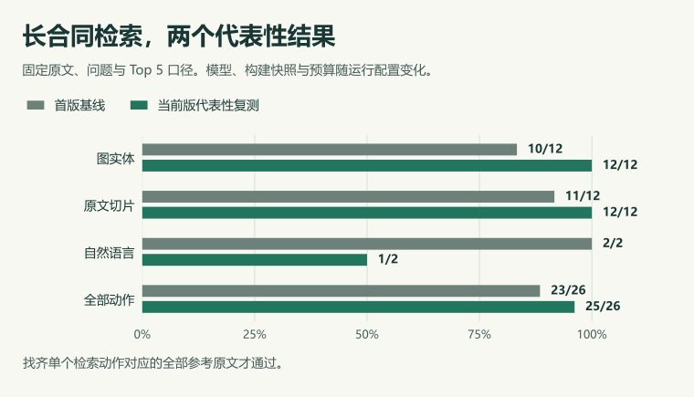
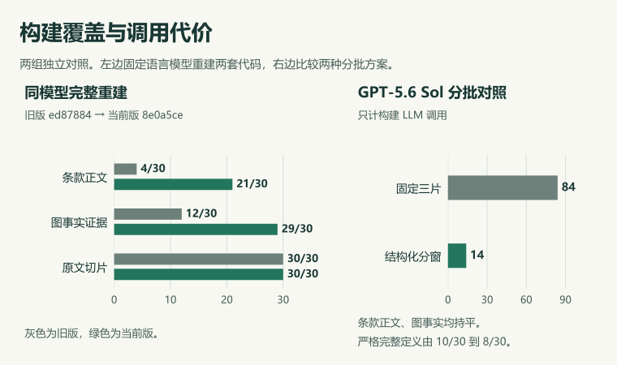
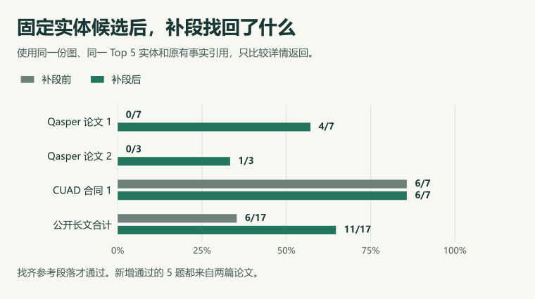

# 评测说明与结果

## 读哪一组

| 想确认什么 | 对照方式 |
| --- | --- |
| 首版和当前版各自达到了多少 | [长合同代表性成绩](#1-长合同代表性成绩)用同一合同和评分口径展示两次实测。 |
| 改进主要来自构建还是检索 | [两版各自重建](#21-两套代码各自重建)观察整条链路，[固定同一份图](#22-固定同一份图只比较检索)只比较检索。 |
| 其他资料上是否有收益 | [公开数据与证据回放](#3-公开数据集与证据回放)区分短文多文档、长文和固定候选回放。 |

## 1. 长合同代表性成绩

这组评测用于展示首版和当前版各自能从完整合同中找回多少证据。输入是 AlliedEsports Content License Agreement 的完整原文，共 35,525 字节、35,504 字符。12 个官方问题分别走图实体和原文切片两路，另有 2 个自然语言检索动作，共 26 个。每次取 Top 5，找齐该动作对应的全部参考原文才通过。

图实体路线检查返回实体详情中的条款正文。原文和自然语言路线检查初次返回的切片。已入图正文、事实引用和补充上下文分别计量。构建只读取原文，19 类正例的 30 个标注段落只用于评分。其余 22 类官方负例留待专门测试。

两轮固定合同、问题和评分规则，各自使用以下配置。

| 配置 | 首版发布基线 | 当前版代表性复测 |
| --- | --- | --- |
| 构建快照 | 21 个切片同批抽取，另做一次引用修复 | 复用已发布的结构化构建快照 |
| 语言模型 | GLM‑5.3 | GPT‑6 Sol 用于重排与两次自然语言规划 |
| 查询向量 | Gemini Embedding 2 | text-embedding-3-large |
| 检索总预算 | 180 秒 | 150 秒 |

原有的 GLM‑5.3 调用额度用完后，后续复测改用 GPT‑6 Sol。两轮在这份长合同上的证据覆盖成绩接近，构建快照、查询向量和检索预算也有变化。单项收益见后面的固定条件对照。

| 检索方式 | 首版基线 | 当前版代表性复测 | 差值 |
| --- | ---:| ---:| ---:|
| 图实体与详情取证 | 10/12 | 12/12 | +2 |
| 原文切片 | 11/12 | 12/12 | +1 |
| 自然语言组合检索 | 2/2 | 1/2 | −1 |
| **合计** | **23/26** | **25/26** | **+2** |

首版漏了最低付款承诺的实体检索，以及许可授予的实体和原文检索。当前版找齐这三项，剩下「终止后授权」漏掉了 5 段中的前置授权范围。两个成绩都衡量证据是否找齐，最终答案需要另外评分。

首版运行 `e316c7ca-7974-4b6d-9392-45868da2d2d7` 有 68 个实体（63 个 Clause）、67 条关系、335 条来源贡献和 21 个切片。三路分别完整覆盖 15/18、17/18 和 9/9 个参考段落。已采用条款正文覆盖 20/30 个官方标注段落，分母包含主体和日期等非条款标注。 [全部 26 次查询](../../evals/published/latest/questions.json) · [原始检索明细](../../evals/published/latest/retrieval.json) · [图谱覆盖](../../evals/published/latest/coverage.json) · [构建诊断](../../evals/published/latest/issues.json)

当前版复测的检索代码快照为 `4531b68`，功能合入 `8e0a5ce`。[优化对照摘要](../../evals/published/optimization-summary.json) 提供逐题计分。详细运行记录留在本地评测工作区的 `contract-26-model-ab-gpt-6-sol-structure-verified/compact.json`。

## 2. 同一长合同上，提升发生在哪一层

构建、重排和详情分别影响三件事：证据有没有入图、相关对象能不能进前五、已命中对象能不能给出足够原文。下面先对比整套版本，再冻结快照比较检索代码，最后回看分窗和模型选择。

### 2.1 两套代码各自重建

旧版取 `df1ccd8d` 的父提交 `ed87884`，当前版取 `8e0a5ce`。两版从同一原文各自建库，使用 GPT‑6 Sol 做构建和检索，向量都用 text-embedding-3-large，再跑相同的 26 个动作。每版保留自己的合同模型配置，因此这一组比较完整版本的实际表现。旧版调用仅在传输层把 `max_tokens` 字段改为 `max_completion_tokens`，两边的输出上限数值一致。

| 指标 | 旧版 `ed87884` | 当前版 `8e0a5ce` | 差值 |
| --- | ---:| ---:| ---:|
| 首轮抽取窗口 | 1 | 5 | +4 |
| 构建 LLM 调用 | 1 | 14 | +13 |
| 入图条款正文覆盖 | 4/30 | 21/30 | +17 个参考段落 |
| 全图可核验的事实证据 | 12/30 | 29/30 | +17 个参考段落 |
| 已索引原文切片覆盖 | 30/30 | 30/30 | 持平 |
| 图实体检索 | 1/12 | 11/12 | +10 个动作 |
| 原文切片检索 | 12/12 | 12/12 | 持平 |
| 自然语言组合检索 | 2/2 | 1/2 | −1 个动作 |
| **检索合计** | **15/26** | **24/26** | **+9 个动作** |

两版都索引了 21 个物理切片，差异集中在入图后能从实体取回多少证据。当前版用更多构建调用换来了图覆盖。下面三题说明了图侧收益和仍有缺口的路线。

| 检索动作 | 旧版覆盖 | 当前版覆盖 | 差异 |
| --- | ---:| ---:| --- |
| 最低付款承诺，图实体 | 0/1 | 1/1 | 当前图实体返回完整参考清单。 |
| 许可授予，图实体 | 0/4 | 3/4 | 图侧多找回三段。两版原文路线都找齐四段。 |
| 终止后授权，自然语言 | 5/5 | 4/5 | 当前版漏掉前置的原始授权范围。 |

### 2.2 固定同一份图，只比较检索

这一组把冻结全文归档 `b1afbd7c…` 的旧检索模块和当前检索模块接到同一份已发布的结构化快照上。两组共用原文、图、向量索引、Top 5 和 GPT‑6 Sol。这里的旧实现来自另一个冻结归档。它和上一组的 `ed87884` 各有自己的出处。

| 检索方式 | 冻结归档检索 | 当前检索 |
| --- | ---:| ---:|
| 图实体 | 12/12 | 11/12 |
| 原文切片 | 12/12 | 12/12 |
| 自然语言组合 | 2/2 | 2/2 |
| **合计** | **26/26** | **25/26** |

这一轮只有「许可授予」的图实体动作不同，旧检索覆盖 4/4 段，当前覆盖 2/4 段。固定图后，当前检索没有复现完整重建组的优势，说明两项收益要分开看。两组原始摘要分别留在本地的 `sol-exact-revision-ab/summary.json` 和 `sol-original-v-current/summary.json`。

### 2.3 比较构建方式与调用代价

**早期 GLM‑5.3 对照**使用同一长合同和业务模型，分别验证旧全文、逐字字段协议后的全文，以及固定三片组批。这个阶段主要排查分片截断、原文范围校验与组装开销。

| 方案 | 首轮批次 | 完整条款定义 | 图事实证据 | 全链路模型请求 | 检索 |
| --- | ---:| ---:| ---:| ---:| --- |
| 早期全文归档 | 1 | 10/30 | 28/30 | 65 | 23/26 |
| 逐字字段协议后的全文 | 1 | 17/30 | 29/30 | 65 | 24/26 |
| 固定三片一批 | 7 | 3/30 | 23/30 | 106 | 8/10 已执行，随后额度耗尽 |

固定小批的 106 次请求中有 55 次用于组装。表中的完整条款定义要求正文与必要引用均完整，和后面单计条款正文的口径有区别。运行标识、阶段调用数和候选失败分类见[评测程序说明](../../evals/README.md#效果优化实测记录2026-11-08)。

**GPT‑5.6 Sol 组窗对照**沿用该合同，逐步从固定三片改成结构化大窗、缩窗，再加入行内标题识别和定向补全。这里把构建 LLM 调用单独计数，检索采用该轮实际构建的图。

| 抽取方案 | 首轮窗口 | 构建 LLM 调用 | 条款正文 | 图事实证据 | 当轮检索 |
| --- | ---:| ---:| ---:| ---:| ---:|
| 历史单窗全文 | 1 | 1 | 9/30 | 17/30 | 16/26 |
| 固定三片一批 | 7 | 84 | 21/30 | 29/30 | 24/26 |
| 结构化大窗 | 2 | 6 | 18/30 | 25/30 | 22/26 |
| 缩窗中间版 | 6 | 19 | 21/30 | 29/30 | 24/26 |
| 缩窗、行内标题和定向补全 | 5 | 14 | 21/30 | 29/30 | 24/26 |

下图把两种不同的问题分开。左侧是两套代码各自重建后的入图覆盖，右侧是同一历史实验里两种分批方案的构建调用数。

结构化分窗在条款正文和图事实覆盖持平时，把固定小批的构建调用从 84 次降到 14 次。14 次包括 5 次首轮抽取、5 次补全和 4 次跨窗连接，原文映射审计零错误。严格完整定义覆盖由 10/30 到 8/30，这一指标还要求正文与必要引用均完整。能在一个窗口内处理的资料仍可用全文优先。

### 2.4 为什么保留原召回与紧凑重排

这一组筛选了证据评分、候选限额、混合证据、补位和事实顺序等变体。先在同一份长合同上重复运行，再用独立多文档样本检查退步。每行的两个分数只在该行条件内比较。

| 测试 | 对照 | 结果 |
| --- | --- | --- |
| 长合同重复两轮 | 原紧凑重排与事实紧凑重排 | 两组都是 49/52。独立多文档的同组复跑都是 22/22。 |
| 混合证据 | 紧凑输出与增加证据选择的混合输出 | 曾同为 25/26，但该轮混合输出 token 从 2,735 增至 7,646。 |
| 独立多文档样本一 | 5 篇、27 个切片，共 11 个动作 | 两组均为 11/11。 |
| 独立多文档样本二 | 15 个问题，实体和原文各跑两轮 | 两组均为 60/60，证据范围均为 92/92，来源隔离零错误。 |

重复运行与留出样本支持保留原召回和单次短 ID 输出。混合方案在该轮达到同等通过数，但模型输出更长。两套实现都满分的留出样本适合做回归检查，比较上限还需要更难的题。

### 2.5 同一结构化快照换模型

这组复用同一结构化快照，查看重排和自然语言规划对模型选择的敏感度。历史 GPT‑5.6 Sol 使用当时的紧凑重排及详情实现，后三行使用当前链路。

| 模型 | 图实体 | 原文切片 | 自然语言组合 | 合计 |
| --- | ---:| ---:| ---:| ---:|
| GPT‑5.6 Sol，历史记录 | 12/12 | 11/12 | 2/2 | 25/26 |
| GPT‑6 Luna | 10/12 | 11/12 | 2/2 | 23/26 |
| GPT‑6.1 Terra | 11/12 | 11/12 | 1/2 | 23/26 |
| GPT‑6 Sol | 12/12 | 12/12 | 1/2 | 25/26 |

单题复跑把「终止后授权」固定到相同的 21 个候选，用 Terra 对两种重排各跑 6 次。初始授权条款已进模型，两组每次都只覆盖 4/5 段。这道题的证据已经被召回，难点是把回答所需的前置条件留在前五。

## 3. 公开数据集与证据回放

### 3.1 短文多文档，比较融合顺序与紧凑重排

TechQA 选取真实技术支持问题，把 8 道有答案题对应的技术说明和 4 篇其他说明放入同一知识库。通过要求在正确原文中找齐答案范围。HotpotQA 选取 4 道桥接和 4 道比较题，把两篇支持来源和一篇干扰摘要放到每题的候选语料中，合并为 24 篇。通过要求找齐全部金标支持句。

两库用相同的 Fact/Topic 模型、结构化构建、GLM‑5.3 和 Gemini Embedding 2。对每个数据集，固定发布快照和检索预算 15 秒，分别按融合顺序和紧凑重排取 Top 5。查询时不指定金标文档。

| 样本 | 文档长度 | 有答案题 | 图实体，融合 → 紧凑重排 | 原文，融合 → 紧凑重排 |
| --- | --- | ---:| ---:| ---:|
| TechQA，12 篇 | 612–5,675 字符 | 8 | 5/8 → 5/8 | 8/8 → 8/8 |
| HotpotQA，24 篇 | 92–1,064 字符 | 8 | 5/8 → 7/8 | 8/8 → 8/8 |

紧凑重排在 HotpotQA 的跨来源题上多找齐两题，TechQA 的实体路线持平。TechQA 全图事实正文只覆盖 6/8，固定已排序实体、补编号步骤与示例后，图侧从 5/8 到 7/8。这说明补详情能回收一部分已命中的证据。缺失事实或候选仍要分别排查。

TechQA 的 8 道官方无答案题另用引用探针，全部弃答。8 道有答案题中，5 题判有依据、1 题弃答、2 题引用校验未通过。短文评测有两次发布核验受告警字段缺省值影响，隔离进程对齐默认值后重放原计划，继续检查实际存储。表中为恢复后的诊断成绩。

### 3.2 公开长文，比较完整检索和跨窗口取证

选两篇 Qasper 论文和两份 CUAD 合同，长度覆盖约 4 万到 6.6 万字符。论文保留章节和正文，按标注段落评分。合同保留完整文本和官方字符坐标，按精确条款范围评分。各文档独立建库，使用结构化构建、GLM‑5.3、Gemini Embedding 2、原召回与紧凑重排，检索预算为 15 秒。

| 样本 | 字符数 | 物理切片 / 首轮窗 | 实际评分题数 |
| --- | ---:| ---:| ---:|
| Qasper 论文 1 | 41,598 | 32 / 5 | 7 |
| Qasper 论文 2 | 64,545 | 51 / 8 | 3 |
| CUAD 合同 1 | 52,252 | 34 / 7 | 7 |
| CUAD 合同 2 | 66,442 | 41 / 10 | 0 |

共冻结 23 题，其中 6 题随第二份合同在跨窗连接阶段因模型额度耗尽而未执行。完成的 17 题中，原文通过 **14/17**，图实体通过 **6/17**。其中 4 道跨窗口题，原文通过 2 道，图实体通过 1 道。长文样本说明原文是有效的补充路线，也暴露出图侧对分散证据的覆盖缺口。

### 3.3 固定实体候选，单独比较详情补段

这组固定已排序的 Top 5 实体及其原有证据。旧详情已支持步骤和示例，当前详情再尝试补回命中位置所在的完整段落。图、候选和排序保持相同。两边都以找齐每题全部参考段落为通过。

| 固定候选样本 | 补段前 | 补段后 |
| --- | ---:| ---:|
| Qasper 论文 1 | 0/7 | 4/7 |
| Qasper 论文 2 | 0/3 | 1/3 |
| CUAD 合同 1 | 6/7 | 6/7 |
| **公开长文小计** | **6/17** | **11/17** |
| TechQA | 7/8 | 7/8 |
| HotpotQA | 7/8 | 8/8 |
| 原始长合同图实体 | 12/12 | 12/12 |
| **全部回放** | **32/45** | **38/45** |

收益主要在两篇论文。新增段落补齐了已命中实体的证据，原有事实引用仍单独保留。两篇论文每题新增上下文中位数为 2,996 和 2,753 字符，按一题多个详情去重后的总量统计。每个详情最多附加 2,400 字符，补段会增加返回文本。

### 3.4 固定原文候选，单独比较来源位置和备选

这组固定原文融合候选，两边都用 GPT‑6 Luna。旧版按原紧凑输入重排，当前版给可核验切片附来源区间，并要求同时选出少量备选。第二轮走正式代码路径，重排预算为 5 秒。原始合同一栏包含 12 个切片检索和 2 个固定原文路线的查询。

| 样本 | 首轮旧 → 新 | 第二轮旧 → 新 |
| --- | ---:| ---:|
| Qasper 与 CUAD 公开长文 | 13/17 → 14/17 | 13/17 → 13/17 |
| 原始合同原文路线 | 13/14 → 13/14 | 12/14 → 13/14 |
| TechQA | 8/8 → 8/8 | 8/8 → 8/8 |
| HotpotQA | 8/8 → 8/8 | 8/8 → 8/8 |
| **合计** | **42/47 → 43/47** | **41/47 → 42/47** |

两轮各净多通过一个动作。第二轮 Qasper 一题改善、一题回退，原始合同的一次改善伴随旧重排超时。重排耗时中位数由 2.41 秒到 2.76 秒，返回文本长度大致持平。这项改动的优势是能按来源位置识别完整包含，给其他片段留位。现有样本只观察到小幅覆盖收益，同时有额外耗时。

### 3.5 共享证据组装实验

独立实验 `e7d25fa` 固定快照、模型、融合候选和请求预算，对同一检索动作比较共享证据组装关闭与开启。59 组配对总体覆盖持平。部分混合查询耗时下降，公开长文则出现覆盖回退。该实验留在 `experiment/evidence-assembly`，两套路线的结果分别统计。

## 4. 当前版的优势与仍需验证的场景

长文部署时，建库调用、返回证据的长度和查询耗时都影响取舍。工程能力则看来源是否正确撤回、写入是否可恢复。

| 当前版改动 | 比较后的判断 | 适用边界 |
| --- | --- | --- |
| 结构化分窗与定向补全 | 同模型重建时图事实覆盖和图实体通过数明显提高。条款正文和图事实覆盖持平时，结构化分窗比固定小批节省构建调用。 | 与预算内的单次全文相比仍需更多调用。两种构建策略都保留。 |
| 紧凑重排与实体详情补段 | 补段在固定实体候选的论文样本上有明确收益。短 ID 重排在留出样本维持覆盖，也比该轮混合证据输出更短。 | 固定图的完整检索有一题回退。原文重排收益较小，涉及前置条款或跨窗证据的题仍易漏段。 |
| 差量写入、并行准备与恢复 | 差量计划和边界检查覆盖来源隔离、冲突组、持久化计划与恢复语义。分布式故障用例可单独验证准备接管与重放。 | 当前表中的检索成绩只衡量样本证据覆盖。生产容量、并发、高可用与最终答案仍各需独立验收。 |

## 5. 工程验证与复现

首版长合同有 55 项机械检查通过。当前实现的工程回归使用固定或可独立核验的输入，检查程序边界与故障行为，和真实模型的证据得分分开记录。

| 验证 | 检查重点 |
| --- | --- |
| Ruff、格式和静态评测入口 | 代码规则、评测输入、标注坐标和配置可读性。 |
| `evals.quality_retrieval_evidence` | 主证据预算、来源隔离、同源完全包含、部分重叠保留、无效候选 ID 和超时回退。 |
| `evals.quality_deterministic` 与 `evals.quality_review_regression` | 分窗授权、逐字引用、关系端点、差量计划、冲突组、范围核验与恢复语义。 |
| 分布式 Worker 故障用例 | 使用隔离存储与固定模型响应，检查准备进程退出后的草稿接管、同库队头、计划重放与迟到写入。 |

仓库保存原始长合同，以及 12 篇 TechQA、24 篇 HotpotQA 摘要、1 篇额外 CUAD 合同和两组共 12 篇多文档留出样本。Qasper 两篇论文和 CUAD 合同 2 可从发布件还原，固定问题与原文校验值随仓库保存。复跑使用独立知识库和运行目录。历史固定候选对照仍依赖当时的快照。 [公开原文与题目](../../evals/corpus/public/README.md) · [独立多文档样本](../../evals/corpus/holdout/README.md) · [复跑入口](../../evals/README.md#公开语料与多文档留出样本) [语料许可](../../evals/corpus/cuad-long/source-manifest.json) · [发布证据](../../evals/published/README.md) · [分布式 Worker 故障用例](../../evals/README.md#分布式-worker-故障验收)

设计与参数取舍见[迭代优化设计](../02-项目设计/迭代优化设计-2026-11-08.md)。
