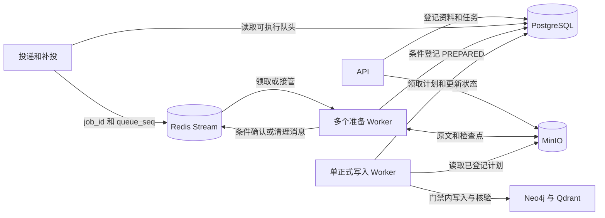
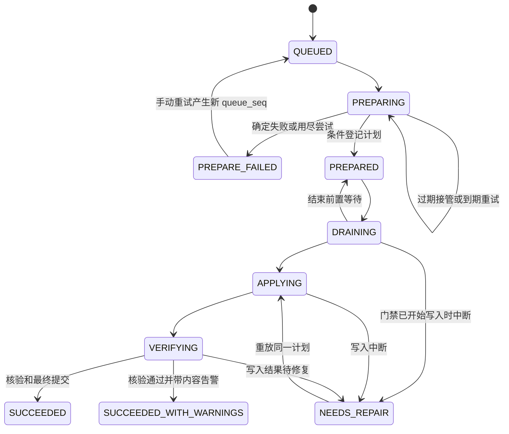

# 多 Worker 调度与准备接管

## Goal Capsule

- **目标** 不同知识库可以在不同机器上同时准备。准备 Worker 失联后，另一台机器能接续任务。同库的业务操作保持原顺序，查询只读取核验完成的知识。
- **方式** Redis Streams 投递和移交准备任务，PostgreSQL 保存任务状态与计划引用，MinIO 共享原文和计划。单个写入 Worker 执行正式写入。
- **执行边界** 本方案供后续实现与验收。以本轮明确约定及以下要求为准。现有 API、CLI 和任务结果契约继续可用。

## Product Contract

### Problem Frame

当前 `Worker.run()` 持有本机进程锁，启动时统一恢复任务，再串行准备并写入。PostgreSQL 的行锁只保护领取事务。`preparation.json`、`prepared.json` 和上传原文都依赖本机路径，另一台机器无法续跑。相关入口在 `src/knowledge_graph/worker.py`、`src/knowledge_graph/adapters/metadata/postgres.py` 和 `src/knowledge_graph/adapters/files/local.py`。

### Requirements

- R1. 不同知识库的准备任务可以并行，同一知识库的导入、删除、重建和重索引按现有队头规则执行。
- R2. 准备阶段允许自动接管。已确认的检查点可复用，同一排队代次只接受一份正式计划。
- R3. `jobs` 保留任务状态、请求、结果和计划引用。Worker 归属和心跳保存在 Redis。首版沿用现有任务字段。
- R4. MinIO 共享原文、准备检查点、正式计划和可复用的抽取结果。原文下载、上传幂等比较、删除和既有恢复行为都能通过新入口执行。
- R5. 正式写入由一个执行器负责。写入阶段保持查询门禁，故障恢复沿用已登记的计划。自动跨机接管覆盖准备阶段。
- R6. 数据库提交后即使 Redis 投递丢失，任务也能补投。重复消息、旧队列代次和超时 Worker 不得发布过期结果。

### Scope Boundaries

首版让准备 Worker 跨机运行。API、正式写入 Worker 和本机读写门禁部署在同一台主机。正式写入的跨机移交、跨机查询门禁、更新期间持续可读、全局模型限流和基础设施高可用另行设计。新环境用隔离的任务库、Stream 和对象桶验收。已有本地原文和计划的部署在启用前单独盘点及确认切换方式。

## Planning Contract

### Key Technical Decisions

- KTD1. Redis Streams 负责投递与准备接管，PostgreSQL 的 `jobs` 负责状态和发布裁决（session-settled: user-approved，沿用既有任务表及字段）。每个 `(job_id, queue_seq)` 有一条有效消息。`queue_seq` 区分重新排队，`attempt` 区分同一排队代次的执行尝试。准备 Worker 的所有状态回写都校验这两个值和允许的当前状态。用户手动重试仍校验 `retry_generation`。
- KTD2. MinIO 共享构建材料（session-settled: user-directed）。文件引用交给现有存储端口处理，`raw_path` 和 `plan_path` 在分布式模式存对象键。原文与正式计划各写独立对象。检查点按尝试隔离，本地文件仅用于临时上传、解析及当前 API 与写入 Worker 的锁。
- KTD3. 保留单正式写入执行器（session-settled: user-approved）。保留已有计划格式、校验和门禁。正式写入恢复仍执行原计划，跨机接管到 `PREPARED` 为止。

### High-Level Technical Design

状态图聚焦两阶段执行。已删除资料的重复删除直接完成，已失效的导入沿用现有 `INVALIDATED` 分支。
#### 入队与补投

1. 上传沿用大小限制和本地暂存。原文对象写成功后，才在同一 PostgreSQL 事务登记资料和任务。HTTP 202 表示登记完成。Redis 投递出错时保留已登记任务并记录错误，补投进程重新发现它。
2. 由一个投递循环负责首投和补投。API 提交成功即可返回 202，投递循环独立于正式写入耗时，按 `queue_seq` 游标分批扫过并回绕，避免长时间占用的队头耗尽每批扫描配额。候选包括到期的 `PREPARING`，即使尝试已耗尽也可补投，以便接管者判定失败。前一任务退出队头后，投递循环在下一轮扫到该库时投递新队头。首版不另设 API 直投路径。
3. Redis 脚本为 `(job_id, queue_seq)` 记录对应的有效消息 ID，并在同一次执行中完成检查与 `XADD`。投递时检查已有条目是否仍存在，丢失时重建。消费者在工作前校验消息仍有效，重复或旧代次的消息可以确认并回收。首版使用一个 Stream 和一个消费组，清理只针对已确认的条目。需要重建消费组时从 `0-0` 读取仍保留的消息。

同库入队和手动重排都先锁 `knowledge_bases` 行，再在事务内检查任务与重试代次并分配 `queue_seq`。这样较早的入队尚未提交时，较晚的重排无法先提交并开始准备。`PREPARE_FAILED` 释放旧队头，手动重试按新序号排队。

#### 领取、续期与计划登记

1. 准备 Worker 通过 `XREADGROUP` 领新消息，通过 `XAUTOCLAIM` 分批领回超时未确认的消息。每个进程使用唯一消费者名，一次准备一个任务。每次先读 PostgreSQL 的任务状态、排队代次和旧 `attempt`，再确认 Redis 中的有效消息及归属，最后用所读状态与代次做条件更新，登记新的 `attempt`。同一事务核对该任务仍是可执行队头、退避已到期且资料操作有效。条件更新失败后，只有重新取得数据库快照并复核 Redis 归属才能再试。
2. 心跳通过 Redis 脚本核对有效消息 ID 与 PEL 持有者，再用 `XCLAIM ... JUSTID` 刷新空闲时间。失去归属就停止准备及续期。较长的模型调用独立于心跳，沿用已有超时。初始联调建议每 10 秒心跳，60 秒后允许接管，按故障演练调整。
3. 可重试错误先按当前 `attempt` 记录错误和 `next_attempt_at`，保留消息待接管。提前收到消息的 Worker 遵守退避时间。已经耗尽尝试的中断任务由接管者条件标记为 `PREPARE_FAILED`，无需再增加尝试。准备重试使用现有次数规则。
4. Worker 将完整计划写到独立对象键，随后在 PostgreSQL 原子更新 `plan_path`、`plan_id` 和 `PREPARED`，并设置 `last_step=prepared` 作为首次正式写入的待领取标记。条件是同一 `queue_seq`、同一 `attempt` 且状态仍为 `PREPARING`。同一条件也保护失败及重试回写。Redis 接管后由 PostgreSQL 接受新 `attempt` 的时点切换提交资格。若 A 先封存成功，B 看到 `PREPARED` 后沿用该计划。若 B 先登记新尝试，A 的提交失败。
5. Redis 确认脚本总是先核对 PEL 持有者。有效消息只在 PostgreSQL 已登记计划、准备已终止或排队代次已失效后确认。已被其他有效 ID 替代的重复消息只确认并删除旧条目，保留新映射。如果映射缺失，数据库已登记计划、准备已终止或排队代次已失效时，当前 PEL 持有者仍可确认该条目。只有映射仍指向本次确认的 ID 时才删除映射。数据库提交结果未知时重新读状态裁决。`PREPARED` 任务可由正式写入 Worker 继续执行，即使此时 Redis 不可用。

#### MinIO 对象与恢复

| 内容 | 键的形状 | 恢复与回收 |
|---|---|---|
| 原文 | `raw/<kb_id>/<document_id>/<generated-name>` | 原文写入确认后才登记，上传结果不明的请求重试时使用新键。下载持有现有读门禁直到响应流结束，重复上传仍逐块比较内容。 |
| 尝试标记和草稿 | `jobs/<job_id>/<queue_seq>/<attempt>/{scope,preparation}.json` | 同一尝试串行保存草稿。新 Worker 从最近可读、基线兼容的尝试恢复，并在自己的路径写入。 |
| 正式计划及抽取结果 | `jobs/<job_id>/<queue_seq>/<attempt>/{prepared,extraction-results}.json` | 正式对象只发布一次，写好后才更新数据库指针。抽取复用从已完成任务的计划前缀定位。 |

草稿沿用当前的任务归属、模型修订、解析参数和有效资料校验。没有可用草稿时重新准备。正式写入和重放直接使用已登记的 `plan_path`，校验对象键与计划封装中的任务、排队代次和计划 ID。准备尝试号来自已登记路径，后续写入重试可能改变 `jobs.attempt`。已登记计划缺失、损坏或暂时不可读时保留任务和错误，继续走既有修复规则。

每次尝试第一次上传材料前，先写无正文的 `scope.json`，再复核 PostgreSQL 的准备代次。检查通过后才发送含正文的材料，确保需要防护的在途写入都有已存在的尝试标记。材料使用固定键。第一次写入要求键不存在，草稿更新使用上一次成功写入的 ETag 做条件写。遇到冲突或写入结果不明，结束当前尝试，避免旧写入后来覆盖新进度。

保留期和孤立对象回收复用写入侧的维护循环。原文上传与孤立原文回收继续共用来源锁。回收从任务或资料前缀分页枚举对象，再核对数据库状态。`QUEUED`、`PREPARING` 的当前排队代次整体保留，覆盖待登记计划和接管草稿。已登记计划及其抽取结果在正式写入和修复完成前保留，成功任务沿用原保留期。巡检也复扫已退役且没有 `plan_path` 的前缀。普通回收与显式删除共用下述封存规则。旧尝试仍可能有在途 PUT 时，保留其 `scope.json` 和关闭标记，保留期到达也不能单独移除它们。

显式删除留在正式写入的重放路径，核验后清理计划指定的对象，再提交最终状态。清理目标必须是授权的原文键或按路径段匹配的任务前缀。沿用原有归属检查，覆盖旧排队代次和间接引用来源的检查点。对已登记且已完成全部材料写入的尝试，可按实际键删除。如果受影响的旧尝试仍可能有在途 PUT，先将其固定材料键覆盖成无正文的关闭标记，再确认删除。不存在的键也写关闭标记。迟到的首次 PUT 会因键已存在被拒绝，旧草稿更新会因 ETag 改变被拒绝。适配器遇到关闭标记或条件不成立就停止该尝试的写入，不能读取新 ETag 后覆盖。确认旧尝试已退出且在途写入已结束后，再回收这些小标记。归属不明的退役草稿按可能含被删资料处理。无法核验对象封存时保持待修复。 [MinIO 条件对象操作](https://docs.min.io/aistor/developers/s3-api-compatibility/)

#### 正式写入和故障判定

正式写入 Worker 使用专用领取入口，仅处理 `PREPARED` 及既有写入恢复状态。单执行器选中任务和读取计划时保留 `last_step=prepared`。核对任务状态及重试代次后，在进入排空的事务中一并登记任务和门禁的 `DRAINING` 状态及首次写入已领取的标记。首次领取沿用非零准备尝试，即使 `attempt=3` 也可执行。若手动重试已清零，实际执行从第 1 次计数。

重启时，选中后尚未进入排空的任务仍可领取。已登记首次排空且门禁确认尚未进入写入、也未记录本次错误时，可恢复该次排空。明确的计划读取失败、排空超时或已进入写入的恢复按现有次数和退避处理，失败记录消耗当次额度。启动恢复范围限定在写入相关状态。沿用按库读写锁、计划写入顺序、核验及最终状态提交。准备 Worker 正常退出时先停止新领取，保存可确认的进度，未完成消息留给超时接管。

| 失败点 | 系统行为 |
|---|---|
| PostgreSQL 已提交，Redis 尚未投递 | 补投进程从 `jobs` 恢复。 |
| 已读消息，尚未更新任务 | Redis 回收空闲消息。新 Worker 再按数据库状态领取。 |
| 草稿已保存，准备 Worker 失联 | 新 Worker 沿用同一排队代次下的兼容草稿。未保存的模型计算可能重做。 |
| 计划已上传，数据库尚未登记 | 当前准备代次下的对象继续保留。后续只执行数据库选中的计划。退役对象按前缀回收。 |
| 已登记 `PREPARED`，尚未确认消息 | 消息可被重领并确认，已有计划直接交正式写入。 |
| 正式写入中断 | 同机恢复时保持门禁并重放。写入主机失联且结果不明时保持待修复，待旧执行器与在途写入已确认结束再恢复。 |

### Deployment and Dependencies

- 首版以显式分布式模式启用。API 和正式写入 Worker 共用原来的本机锁目录，准备 Worker 可以独立部署。现有本地入口与评测运行方式继续可用。一次部署的同一任务库只允许一种运行方式。
- 配置 Redis 连接、Stream、消费组、心跳和接管阈值。配置 MinIO 私有桶、地址和环境变量凭据。准备 Worker 依赖 Redis 就绪。Redis 暂停时，API 仍可登记任务，正式写入仍可执行已登记计划。沿用 HTTP、CLI、MCP 任务契约，更新角色入口、示例配置和运行指南。
- MinIO 社区服务端仓库已归档，社区版分发改为源码。联调使用固定且经过验证的 MinIO 发行版。正式部署前确认所用版本、维护来源、许可和运维归属。上线前用选定版本验证条件写入和关闭标记，包括实际使用的上传方式。工作桶按无历史对象版本的方式部署，确保删除后旧内容不可再读。[MinIO 社区仓库](https://github.com/minio/minio) · [MinIO S3 兼容性](https://docs.min.io/aistor/developers/s3-api-compatibility/)
- 对已有本地运行数据，启用分布式模式前检查原文和活动计划的存储位置。先在隔离环境验收。若线上还有本地引用，保留旧部署直至另行完成可核验的迁移。切换时先停领任务并核验现有原文和计划引用。登记过 MinIO 对象引用后，回退版本必须继续能读取它们。恢复纯本地模式前需迁移并核验仍被引用的对象。

## Implementation Units

### U1. 抽出共享对象读写

- **对应要求** R4、R5。主要入口为 `ports/files.py`、`adapters/files/local.py`、`bootstrap.py`、`services/documents/service.py`、`services/construction/pipeline.py` 和 `services/construction/maintenance.py`，均位于 `src/knowledge_graph/`。
- 实现 MinIO 适配及临时路径桥接。原文上传、下载、字节比较、草稿恢复、抽取缓存、计划读取和清理共同经过对象接口。现有计划封装与验证继续复用。
- **验证** 两台机器访问同一上传原文和计划。相同幂等键重复请求保持原有返回和冲突规则。删除仅移除计划指定的来源及材料。

### U2. 接入 Redis 准备队列和数据库条件更新

- **对应要求** R1、R2、R3、R6。主要入口为 `src/knowledge_graph/adapters/metadata/postgres.py`、`src/knowledge_graph/ports/metadata.py` 和新 Redis 队列适配器。
- 拆出队头查询、准备尝试的条件登记和结果提交。实现投递去重、补投、确认、超时接管及心跳。采用既有状态与字段。
- **验证** 多消费者竞争时，同库队头只有一份生效计划。丢失投递可补回，旧 `queue_seq` 和过期 `attempt` 的结果不能覆盖当前状态。

### U3. 拆分 Worker 和清理职责

- **对应要求** R1、R2、R4、R5。依赖 U1、U2。主要入口为 `src/knowledge_graph/worker.py`、`src/knowledge_graph/services/construction/apply.py`、`src/knowledge_graph/interfaces/cli/__init__.py` 和运行模板。
- 通过角色启动准备与正式写入。限制各自的领取、恢复、退出与清理路径。正式写入 Worker 和 API 共用查询门禁。
- **验证** 停掉准备 Worker 后可跨机续跑。正式写入 Worker 重启不会重置正在准备的其他任务。中断正式写入时重放原计划。

### U4. 联调、故障演练与切换说明

- **对应要求** R1 至 R6。依赖 U1 至 U3。更新 `configs/` 和现有运行指南、实施设计。接入路径及故障演练写入同一套运行说明。
- 使用真实 Redis、MinIO、PostgreSQL、Neo4j 和 Qdrant。用短合成文档和可控故障注入验证机制。联调环境使用固定镜像版本与独立数据位置。

## Verification Contract

| 验收点 | 必须看到的结果 |
|---|---|
| 同库与异库 | 两个库的准备能重叠。同库后一个任务在前一个占用队头时不能开始准备，覆盖退避、正式写入和待修复。模拟较早导入暂停提交，验证手动重排无法抢先准备。`PREPARE_FAILED` 释放旧队头，手动重试取得新序号。 |
| 接管与旧执行器 | 在 A 保存草稿后停止其心跳，B 从另一台机器接管。恢复 A 后，A 无法续期、确认 B 的消息或提交旧尝试结果。 |
| 丢消息与重复消息 | 模拟数据库提交后 Redis 不可用、重复投递、Redis 丢失队列及 PostgreSQL 提交后确认前中断。任务最终能被发现，生效计划只登记一次。有效投递映射丢失后，旧消息能被回收且不会删除新映射。已登记计划但映射缺失的条目也能被确认。 |
| 长调用和错误分类 | 长模型请求期间心跳有效。暂时错误遵守退避。第三次准备失联且消息丢失后可终结并释放队头，第三次准备成功后，在首次选中或刚进入排空时中断仍可继续。手动清零后首次正式执行从 1 计数，明确的失败继续受次数上限约束。 |
| MinIO 与清理 | 草稿和计划可由不同主机读取。上传幂等与下载仍正确。暂停在计划上传与登记之间，回收不得移除准备材料。先运行普通回收，再让旧尝试的 PUT 延迟至资料删除后送达，MinIO 拒绝写入。回收保留其他进行中和待修复的材料。 |
| 写入与查询 | 从 Qdrant 或图写入中间中断并恢复。计划 ID、对象 ID、向量和范围一致。核验通过前查询保持门禁。 |

以机制联调为主，保留复现命令和失败点。实现交付前运行项目现有 Ruff、编译检查和相应的最小端到端验证。

## Definition of Done

- 两类 Worker 按已定拓扑运行。Redis 或准备 Worker 短时故障后的任务恢复已通过验收。
- 原文、检查点、正式计划和抽取复用在 MinIO 可用，旧的本地运行方式仍可按原入口启动。
- 正式写入的查询门禁与重放结果符合既有约定。变更只涉及本方案所列的 Worker、存储和运行契约。

## Appendix

- Redis 消费组通过 PEL 记录未确认消息。`XAUTOCLAIM` 按空闲时间移交，`XACK` 按消息 ID 确认，应用在确认前校验消息持有者。[Redis Streams](https://redis.io/docs/latest/develop/data-types/stream/) · [XAUTOCLAIM](https://redis.io/docs/latest/commands/xautoclaim/) · [XCLAIM](https://redis.io/docs/latest/commands/xclaim/) · [XACK](https://redis.io/docs/latest/commands/xack/)
- 数据库提交与消息投递存在两个独立提交点。这里由已有任务表支撑补投和去重。[AWS 关于事务与消息双写](https://docs.aws.amazon.com/prescriptive-guidance/latest/cloud-design-patterns/transactional-outbox.html)
- 正式写入的接管要处理旧 Worker 已发出的在途请求。该风险由存储端的写入代次校验或已确认的旧执行器隔离解决。[写入代次与旧请求隔离](https://martin.kleppmann.com/2016/02/08/how-to-do-distributed-locking.html)
